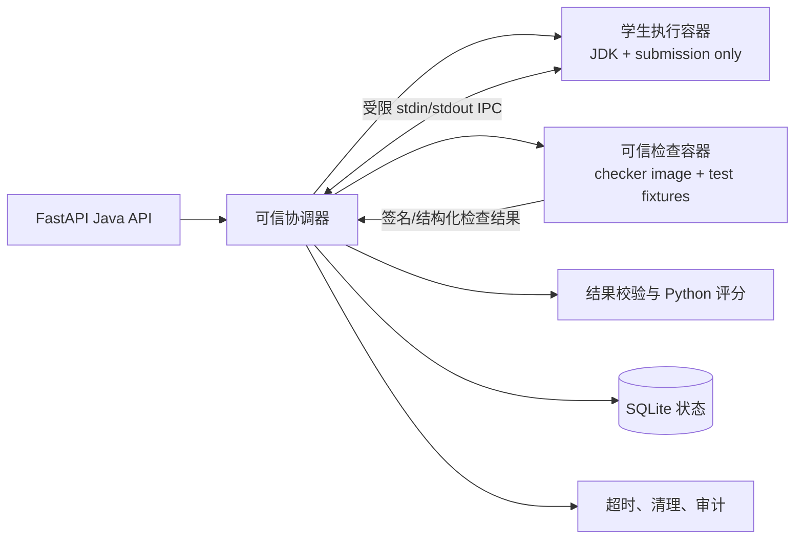

# Java 执行隔离架构方案

日期：2026-11-06。本文是第六阶段的研究方案，不代表本方案已经实现或通过安全验收。本阶段不修改业务代码、评分规则、数据库或 `.env`。

## 1. 当前架构与风险

当前 `backend/java_course.py:run_check` 创建一个 Docker 容器，将学生提交目录挂载为 `/submission`，将临时最小课程 bundle 挂载为 `/course`，然后执行 `checks/run.sh`。`PracticeHarness` 或 `ShopHarness` 在同一个 JVM 中编译学生源码、加载可信检查类、执行学生类和检查逻辑，并输出 JSON。当前已经移除参考答案和无关课程文件的原始挂载，但可信 harness 源码和学生类仍处于同一 JVM。

同一 JVM 不是安全边界。学生代码可以尝试使用 `ClassLoader`、反射、`System.getProperty`、`Files.walk`、异常栈和线程枚举发现检查类或临时文件，也可能干扰可信检查的静态状态、输出和进程资源。只读挂载只能防止写入，不能防止读取。

现有评分和次数逻辑位于 Python：只有 `run_check` 返回 `completed` 才计有效次数；核心/学生测试必要条件、结构分、设计解释评分及 70 分门槛由 `grade_practice` 执行。新架构必须保留这些逻辑。

## 2. 三种方案比较

| 方案 | 优点 | 缺点 | 结论 |
|---|---|---|---|
| A：独立 JVM + 管道 | 改动较小；可把学生 JVM 与检查 JVM 分开；IPC 可做长度、超时和消息校验 | 如果两个 JVM 共享可读的检查器目录，仍会泄露；Java 反射和文件权限必须同时处理；学生代码需要稳定的测试协议 | 可作为过渡或同一容器内的最小隔离，但不能单靠“两个 JVM”宣称安全 |
| B：两个 Docker 容器 | 容器、文件系统、进程和资源边界清楚；学生容器不需要检查器文件 | 需要协调容器、临时 IPC、清理和错误恢复；不能把 Docker Socket 给学生容器 | 推荐作为运行时基础 |
| C：可信宿主机协调器 | 可信协调器掌握评分、次数和结果；学生容器只执行不可信代码；最容易审计 | 需要新增协调协议和任务状态；实现量最大；协调器必须严格处理超时、退出码和临时目录 | 推荐与 B 组合，作为最终架构 |

## 3. 推荐架构

采用“可信协调器 + 学生执行容器 + 可信检查容器”的 C+B 组合。后端只创建任务，不把检查器源码挂载给学生容器。协调器负责准备输入、创建容器、读取经过校验的结果、执行可信评分和清理资源。



### 进程和容器职责

- **FastAPI**：认证、提交记录、检查次数、任务状态和最终评分；不执行学生字节码。
- **可信协调器**：生成一次性任务 ID，创建隔离目录和容器，设置超时，验证协议、退出码和结果摘要，销毁容器。
- **学生执行容器**：只拥有学生提交目录和必要的固定运行时输入；无 Docker Socket、无 `/course`、无参考答案、无其他学生目录；`--network none`。
- **可信检查容器**：只运行已构建并固定版本的检查器镜像和测试 fixture；不挂载学生可写目录；通过一次性输入读取学生程序结果或检查报告。
- **Python 评分层**：继续执行现有 `grade_practice`、`grade_shop`，不接受学生提交的分数或 passed 字段。

## 4. IPC 协议

建议使用协调器创建的一次性 Unix domain socket 或匿名管道；学生容器只连接到该任务的单一端点。若跨容器实现困难，第一版可使用两个一次性 bind mount 文件：协调器写入输入后关闭文件，学生只读；学生写入结果后关闭，协调器以严格权限读取。禁止共享 Docker Socket、宿主机目录根路径或长期 TCP 端口。

消息使用 UTF-8、单行 JSON、最大 64 KiB，并带任务随机 ID：

```json
{"protocol":1,"job_id":"random","kind":"practice-core","case":"CORE-NAME","input":{"...":"..."}}
```

学生返回的消息只表示行为观察值，不表示评分：

```json
{"protocol":1,"job_id":"random","case":"CORE-NAME","status":"ok","observations":{"code":"..."}}
```

协调器检查：协议版本、job_id、case 白名单、字段类型、消息长度、单条消息数量、EOF、退出码和超时。学生不能提交 `passed`、`score`、`necessary` 或 `attempts_used` 作为可信字段。可信检查容器重新执行断言并生成结果；Python 只接受可信容器的结构化结果。

## 5. 文件目录和挂载

每个任务使用独立目录，例如：

```text
DATA_DIR/java-jobs/<random-job>/
  submission/       # 学生提交，容器只读
  input/            # 本任务输入，容器只读
  result/           # 由协调器创建，结果文件一次写入
  metadata.json     # 任务类型和版本，不含密钥
```

学生容器只挂载 `submission/` 和当前任务必要的 `input/`；可信检查器文件在可信检查镜像内，不挂载到学生容器。可信容器只挂载不可写的任务输入或通过 IPC 接收观察值。每个 job 使用随机不可复用目录，创建时使用 `mkdir` 的独占语义并验证规范化路径位于 `DATA_DIR/java-jobs`；拒绝已有目录、符号链接和路径穿越。任务结束后由协调器删除临时容器和目录，保留脱敏审计记录。

## 6. 编译、运行和错误处理

1. 协调器先验证 ZIP、固定文件摘要、路径和大小。
2. 学生容器只编译学生源码及必要的课程固定 API；编译器输出限制长度并作为业务检查失败证据返回。
3. 每个测试案例使用独立学生进程或独立容器；核心检查、学生测试和商店任务不共享可变 JVM 状态。
4. 单案例设置 wall-clock timeout、CPU、内存、PID 和输出上限；超时后先终止进程，再强制删除容器。
5. 编译失败、断言失败属于 `completed` 的业务结果并按现有规则计次；容器创建失败、协调器异常、无法取得可信结果和基础设施超时属于 `environment_failed`，不计次。
6. 内存耗尽、非法退出和输出超限均归类为受控失败，不能让协调器把任意 stdout 当作评分结果。

## 7. 防伪造和数据安全

- 学生返回值只作为未可信观察值；所有通过条件由可信检查器重新计算。
- job ID、协议版本和案例白名单阻止跨任务重放。
- 结果文件由协调器创建，使用随机文件名、独占创建和大小上限；学生容器不能写评分数据库。
- 学生容器无 Docker Socket、无宿主机根目录、无网络、无其他学生目录和无密钥环境变量。
- 容器使用非特权 UID、能力丢弃、`no-new-privileges`、只读根文件系统和有限 `/tmp`；仍保留现有 CPU、内存和 PID 限制。
- Python 评分层只读取可信检查器结果，设计解释仍由教师或受控 AI 评分，不改变客观必要条件。

## 8. 现有代码和镜像改动范围

预计修改：

- `backend/java_course.py`：把同步 `run_check` 改为创建 job、调用协调器、处理状态和清理；保留 `grade_practice`、`grade_shop` 和次数逻辑。
- 新增 `backend/java_executor.py`：任务目录、容器生命周期、IPC、超时、结果校验和审计。
- `training/java-practice/checks/harness/*`、`training/java-shop/checks/harness/*`：改为可信检查镜像内构建，不再作为学生容器挂载内容。
- 新增 `training/java-runtime/Dockerfile.trusted-checker` 和对应构建脚本；镜像固定 JDK、检查器版本和 fixture 摘要。
- `tests/test_java_course.py`：保留现有评分和次数测试，增加 IPC 伪造、EOF、重放、超时、输出超限和跨学生路径测试。

不应修改：评分权重、70 分门槛、核心/学生测试必要条件、三次有效检查次数和数据库业务结构。

## 9. 迁移步骤

1. 先实现协议和纯 Python 协调器的 fake executor，保持现有 API 返回结构。
2. 构建可信检查镜像，在镜像内运行现有 harness，禁止引用宿主机课程目录。
3. 实现学生容器最小镜像和单案例 IPC；先迁移 practice 的一个核心案例。
4. 对照旧 harness 与新协调器的结果，覆盖正确、编译失败、故障版本和超时。
5. 迁移其余 practice 案例，再迁移 shop 三个任务。
6. 在隔离临时数据库上运行完整回归，确认旧提交、设计评分、解锁和重置记录不变。
7. 通过安全测试和人工验收后，才考虑替换默认执行路径；迁移期间保留旧实现但不同时运行两套评分。

## 10. 回归和安全测试

- 正确代码、编译错误、运行时异常、无限循环、内存分配和超大输出。
- 学生代码尝试读取检查器路径、参考答案路径、`/submission/../`、其他 job、`/proc`、Docker Socket 和宿主机敏感路径。
- 学生伪造 `passed`、`score`、结果 JSON、job ID 和重复消息。
- IPC EOF、半行 JSON、超长 JSON、错误协议、错误案例和重放消息。
- Docker 不可用、镜像缺失、容器启动失败、检查器崩溃和协调器超时均不扣有效次数。
- 两个学生同时提交，确认目录、容器、结果和 SQLite 状态完全隔离。
- 运行现有后端测试、前端测试、TypeScript 构建、真实容器检查，并与迁移前结果逐项比较。

## 11. 难度和工作量

这是中高风险的执行架构重构，不应与人工验收并行直接上线。预计：协议和 fake executor 1–2 天；可信检查镜像和学生容器 2–3 天；practice 迁移与回归 2–3 天；shop 迁移、安全测试和文档 2–3 天；另需 1–2 天人工验收和失败修复。总量约 8–13 个工作日，取决于容器协调方式和 Windows/Docker Desktop 兼容性。

推荐先完成一个可回滚的 practice 垂直切片，再决定是否迁移全部任务。当前代码可以继续人工验收，但在完成独立可信/不可信边界前，不应把 Java 检查器描述为达到强隔离安全等级。

## 12. 具体执行流程（推荐实现）

两个容器之间不直接共享 socket、目录或网络。可信协调器使用 Docker attach 的 stdin/stdout 分别连接两个容器，并在内存中转发受限消息：

1. FastAPI 在用户锁内读取提交版本，验证 ZIP 摘要和当前 scope，创建随机 `job_id`。
2. 协调器创建一次性 job 目录，使用独占创建检查所有目录组件，生成 32 字节随机 `nonce`，并把任务类型、课程版本和协议版本写入内存任务记录。
3. 启动学生容器。它只挂载 `/job/submission`，入口是固定的可信 `student-runner`，不接受用户指定的命令、环境变量或镜像。
4. `student-runner` 编译学生源码。编译错误通过 stdout 的未可信观察消息返回；它不能决定最终分数。
5. 对每个白名单案例，协调器发送 `case_start`。学生 runner 执行该案例所需的学生方法或学生测试，返回观察值、退出码和受限日志。学生进程每个案例单独启动，避免静态状态跨案例污染。
6. 协调器验证消息格式后，将观察值和案例元数据流式发送给可信检查容器。可信检查容器只使用镜像内的固定检查逻辑和 fixture，重新计算断言、必要条件和测试结果。
7. 可信检查容器返回带 `job_id`、输入摘要、检查器版本和 HMAC 的 `trusted_result`。协调器验证 HMAC、案例集合、结果数量、输入摘要和 EOF。
8. 协调器把可信结果转换成现有 `run_check` 返回结构；Python 继续调用 `grade_practice` 或 `grade_shop`，决定 `completed`、分数和是否计次。
9. 协调器先终止学生容器，再终止检查容器，删除 job 临时目录，仅保留脱敏的状态记录和结果摘要。

学生程序永远不直接调用可信检查器。学生返回的是观察值，可信检查容器重新计算通过与否；学生测试的“能否发现预设故障”仍在学生容器中执行，但可信协调器只接受固定 runner 的退出码和日志上限，并把它作为学生测试维度输入，不接受学生自报的分数。

## 13. IPC 协议和完整性

推荐使用两个独立的 Docker attach stdin/stdout 流，由协调器做唯一转发方。这样学生容器没有可信容器的 socket，也没有宿主机 Unix socket。每条消息采用 `4-byte big-endian length + UTF-8 JSON`，最大 64 KiB；连接关闭前必须收到明确 `eof`。

请求示例：

```json
{"protocol":1,"job_id":"4f1…","nonce":"base64…","course":"java-practice","case":"CORE-DUPLICATE","input_digest":"sha256:…","command":"case_start","payload":{"competition":"cup","capacity":2}}
```

学生观察示例（不可信）：

```json
{"protocol":1,"job_id":"4f1…","nonce":"base64…","command":"observation","case":"CORE-DUPLICATE","exit_code":0,"payload":{"events":[{"type":"registered"}]},"log":""}
```

可信结果示例：

```json
{"protocol":1,"job_id":"4f1…","case":"CORE-DUPLICATE","input_digest":"sha256:…","checker_version":"java-checker-2026.11.06","status":"completed","checks":[{"key":"CORE-DUPLICATE","passed":true}],"mac":"base64-hmac"}
```

- `job_id`、`nonce`、`protocol`、`course`、`case` 和输入摘要由协调器在发送前固定；所有回包必须逐项匹配当前内存任务。
- 学生端只知道当前 job 的 nonce；nonce 用于防止旧消息重放，但不能用来证明学生结果可信。
- 可信检查镜像启动时通过受保护的环境注入一次性 HMAC 密钥，密钥不进入学生容器、不写入 job 目录；协调器使用独立的 verifier key 校验结果。若容器无法安全注入密钥，则改用协调器通过 Docker attach 获得的受信任容器身份和单次连接，并把结果再由协调器本地生成摘要。
- 禁止学生提供 `passed`、`score`、`necessary`、`design_score` 或 `attempts_used`；解析器遇到这些字段直接拒绝该消息。
- 任何长度错误、协议错误、错误 job、错误 nonce、重复 case、缺少 EOF、MAC 错误或超时都生成 `environment_failed`，不计有效次数。

## 14. 两个容器的权限和挂载配置

| 项目 | 学生执行容器 | 可信检查容器 |
|---|---|---|
| 镜像 | 固定 JDK + 固定 `student-runner`，不含 harness/fixture | 固定 digest 的 checker 镜像，内置 harness、fixture 和 verifier |
| 用户 | UID/GID 10001 | 非 root 专用 UID；需要密钥时使用容器内最小权限读取机制 |
| 网络 | `--network none` | `--network none` |
| 挂载 | `/job/submission:ro`；可选固定空 `/tmp` | 无宿主机 bind mount；检查器和 fixture 位于镜像层 |
| 禁止访问 | `/course`、`/checks`、Docker Socket、其他 job、宿主机根目录、数据库、`.env`、其他学生目录 | 学生提交目录、数据库、`.env`、Docker Socket、其他 job；只接收协调器流式输入 |
| 容器选项 | `--read-only --cap-drop=ALL --security-opt=no-new-privileges --pids-limit=128 --cpus=2 --memory=600m --tmpfs /tmp:rw,nosuid,nodev` | 同等或更严格；检查器结果只能经 stdout 返回 |
| 进程入口 | 固定 runner，忽略学生 ZIP 内脚本和命令 | 固定 checker entrypoint，忽略外部命令 |

可信检查器镜像可以读取自身的检查逻辑，这是信任边界内的行为；学生容器完全没有该镜像层、容器名、socket 或路径。两个容器不共享文件系统，因此“两个 JVM 但共享可读目录”的伪隔离不会出现在推荐架构中。

## 15. PracticeHarness 和 ShopHarness 的迁移

- **PracticeHarness**：拆成 `PracticeCaseRunner`（学生容器侧，只负责编译学生源码、运行学生测试和按 case 返回观察值）与 `PracticeChecker`（可信检查容器侧，保留 `CoreChecks`、fixed API、fault fixture 和结构检查）。`CoreChecks` 不再加载学生类；它接收 runner 产生的结构化观察值，重新判断每个核心案例。
- **ShopHarness**：拆成 `ShopCaseRunner`（学生容器侧，编译 `ShopService` 并执行固定任务适配器）与 `ShopChecker`（可信检查容器侧，执行商品、订单创建、订单查看的检查）。每个 shop task 使用独立 runner 进程和 case ID。
- 学生测试仍由学生容器执行，因为测试代码属于学生提交；可信检查器只判断固定 runner 的退出码、测试清单和受限日志，并不把学生测试输出当成可信评分。
- 现有 `run_check`、`grade_practice`、`grade_shop` 的外部返回结构保持不变，迁移只替换执行层。

## 16. 资源开销和启动控制

每个检查任务同时运行两个容器，初始内存预算约为学生 600 MiB + checker 256–384 MiB，加上 Docker daemon 和 JDK 镜像共享层；CPU 仍按每容器 2 CPU 上限，实际并发应由协调器信号量限制。建议第一版单实例最多 1 个 Java job，确认稳定后再按可用内存增加到 2–4 个。

降低启动开销的方法：预拉取并固定 digest 的镜像、复用只读镜像层、不复用学生工作目录或 JVM、在协调器内使用有界队列、每个 job 设置总超时、结束后立即删除容器。禁止为省启动时间而让两个学生共享 JVM、checker 容器或 `/tmp`。

## 17. 恶意代码安全测试矩阵

每个测试都必须在真实 Docker 容器中执行，并检查退出码、容器存活、可读路径、CPU/内存/进程数和是否计次：

| 类别 | 样例 | 通过条件 |
|---|---|---|
| 文件读取 | 读取 `/course`、`/checks`、`/proc/1/root`、其他 job、`.env`、Docker Socket | 学生容器不存在这些挂载；读取失败；可信结果仍可完成 |
| 文件写入 | 写入 `/submission`、`/tmp` 外的根文件、其他学生目录 | 只读/路径不存在；不能影响 checker 或其他 job |
| 反射与类加载 | 枚举类、读取 classpath、反射 checker 类、扫描线程 | 学生容器没有 checker 类；任务不会污染可信容器 |
| IPC 伪造 | 伪造 passed/score、错误 job、重放旧 nonce、超长消息、重复 case | 协议拒绝；`environment_failed`；不计次 |
| 资源耗尽 | 无限循环、递归、百万线程、超大堆、无限 stdout | 容器被终止；不拖垮其他 job；按业务/环境规则分类 |
| 路径攻击 | ZIP `../`、绝对路径、符号链接、硬链接、Unicode 规范化冲突 | 上传拒绝；没有越界文件 |
| 并发隔离 | 两学生同时运行、同一 job 重放、目录名碰撞 | 目录、容器、结果和次数互不影响 |

在推荐架构完成前，当前同 JVM 实现只能通过“检查器源码未挂载”等缓解测试，不能通过反射/类加载器测试的强隔离门槛。

## 18. V2 修订：学生结果一律不可信

学生容器中的 Java 程序和 student-runner 都属于不可信环境。runner 不得生成或决定 `passed`、`score`、`status`、测试通过数量或任何评分字段。可信流程如下：

1. 可信检查器生成白名单测试案例、输入参数和预期判断规则。
2. 可信协调器为案例创建学生容器，发送仅包含案例 ID、输入和一次性 nonce 的执行请求。
3. 协调器从 Docker attach 分离捕获学生容器的 stdout、stderr、退出状态、启动时间、结束时间、超时、OOM 和输出字节数。
4. 所有捕获内容都标记为不可信字节流；协调器不依据 stdout 中的 `passed`、`score` 或 JSON 直接评分。
5. 可信检查器接收捕获摘要和允许的观察字段，重新执行断言规则，生成可信检查结果。
6. Python 评分层只读取可信检查器结果，执行现有 `grade_practice`/`grade_shop`，最终决定分数、必要条件和是否通过。

需要调用学生 Java 类时，学生类只能在学生容器的学生 JVM 中加载。可信检查器 JVM 不加载学生 class，也不共享 classpath、工作目录或文件系统。学生 JVM 的 stdout/stderr 由协调器捕获后转发为数据；学生代码无法调用检查器 API、修改检查器静态状态或控制检查器进程。

学生自编测试的可信度必须单独处理。任意 Java 测试可以调用 `System.exit`、伪造输出、跳过断言或自行返回成功，因此不能把“测试报告的通过数量”当成可信证据。第一阶段保留现有业务含义时，只把学生测试作为受限 runner 的退出行为和固定故障矩阵观察值输入，由可信 checker 判定退出码是否符合预期；这仍然不能证明测试覆盖质量。后续若要提高可信度，应设计受限测试 DSL/声明式断言集，由可信 runner 执行断言，或把学生测试降级为教学反馈而不作为必要条件。该选择必须另行审核，不能在迁移中悄然改变现有评分规则。

## 19. V2 修订：统一 IPC 和消息完整性

第一版只采用 **Docker attach + 可信宿主机协调器内存转发**。Unix socket、共享临时结果文件、容器间 TCP 和共享目录全部标记为不采用的备选方案；两个容器不直接通信、不共享文件系统、不共享网络，Docker TTY 必须关闭，stdout 与 stderr 分别捕获。

双向流程为：协调器 attach 学生容器 stdin/stdout/stderr；发送 `case_start`；捕获学生 stdout/stderr 和退出事件；协调器将经过大小限制的观察摘要发送给可信 checker 容器 stdin；checker 通过自己的 stdout 返回可信结果；协调器验证后关闭两条 attach 流并销毁容器。

每条 IPC 帧为 `4-byte big-endian length + UTF-8 JSON`。单帧最大 64 KiB；每个案例最多 32 帧、每个 job 最多 512 帧、总 stdout/stderr 各 1 MiB。超过限制立即终止学生任务并归类为 `completed` 的输出超限结果。每个方向都要求明确 EOF；半帧、错误长度、错误 JSON、错误协议版本、未知命令、重复 case、错误 job 或超时均拒绝。

请求示例：

```json
{"protocol":2,"job_id":"job-4f1","nonce":"base64-opaque","command":"case_start","case":"CORE-DUPLICATE","input_digest":"sha256:…","payload":{"capacity":2}}
```

学生回包仅是未可信观察数据：

```json
{"protocol":2,"job_id":"job-4f1","nonce":"base64-opaque","command":"observation","case":"CORE-DUPLICATE","payload":{"stdout":"…","stderr":"…","exit_code":0,"elapsed_ms":31}}
```

可信 checker 回包：

```json
{"protocol":2,"job_id":"job-4f1","case":"CORE-DUPLICATE","input_digest":"sha256:…","checker_version":"checker-v2","status":"completed","checks":[{"key":"CORE-DUPLICATE","passed":true}],"mac":"base64-hmac"}
```

每个 job 生成独立 32 字节随机 HMAC 密钥。密钥只存在于可信协调器内存和可信 checker 的安全初始化输入中，不进入学生容器、学生可读目录、公开镜像或日志。协调器和 checker 使用同一 job key 生成/验证 HMAC；nonce 防止旧消息重放，HMAC 防止结果在传输中被篡改。HMAC 不能证明学生代码诚实、不能阻止学生在自身容器伪造观察值，也不能替代容器隔离和可信 checker 重算。密钥注入失败、MAC 错误或 checker 返回未签名结果都归类为 `environment_failed`。

## 20. V2 修订：独立可信执行器

公网 FastAPI 不直接拥有 Docker Socket。目标部署为：

```text
FastAPI → 受限本地 Executor API → Java Executor → Docker Engine
```

Executor API 只监听 Unix domain socket 或 loopback，使用本机服务账号、一次性 bearer token/相互 TLS 认证和严格的 JSON schema；只允许提交 job、查询 job、取消 job 三类操作，不允许传入任意 Docker 参数。Java Executor 账号只拥有 Docker Engine 所需最小权限，不向 FastAPI 暴露 socket 路径。Executor 故障时返回 `environment_failed`，不计次；job 状态通过受限 API 回传。

若当前部署暂时不能拆服务，兼容方案是在单独的本地 worker 进程中调用 Docker，并让 FastAPI 只通过本机受限队列提交任务。该方案仍有 worker 与主机同权限、服务单点和本地 IPC 配置错误风险，不能作为公网强隔离最终形态。

## 21. V2 修订：有效检查次数和容器配置

以下均为 `completed`，计一次有效检查：编译失败、学生代码运行异常、学生代码超时、学生代码触发 OOM、学生 stdout/stderr 超限。以下均为 `environment_failed`，不计次：Docker 基础设施故障、可信 checker 崩溃、协调器内部错误、镜像拉取/启动失败、协议校验器自身异常。现有三次有效检查、70 分门槛、核心与学生测试必要条件、教师设计评分和重置逻辑全部保留。

学生容器使用 `--read-only` 根文件系统、非 root UID 10001、`--cap-drop=ALL`、`--security-opt=no-new-privileges`、默认 seccomp、可用时启用 AppArmor；只读挂载提交目录，使用大小受限的 `tmpfs /tmp:rw,nosuid,nodev,noexec,size=256m` 存放 `.class` 和编译临时文件。保留 `--network none`、CPU 上限、`--memory` 与 `--memory-swap` 上限、`--pids-limit`、单文件/总文件限制、stdout/stderr 限制和 job 总超时。Docker 共享宿主机内核，不能防御内核漏洞；更高隔离等级可评估 gVisor、Kata Containers 或 Firecracker，但会增加启动时间、镜像兼容性和运维成本。

## 22. V2 分阶段边界

- **7.1 Practice 核心案例垂直切片**：只迁移 `CORE-NAME` 一个案例，完成两个容器、attach IPC、job key、可信结果签名、资源限制和失败分类；不迁移其他核心案例、学生测试、shop 或评分规则。
- **7.2 Practice 其余案例**：迁移核心其余案例、编译失败、运行异常、超时和 OOM 回归；对照旧结果。
- **7.3 Shop 三个任务**：逐一迁移商品查询、订单创建、订单查看；保持顺序解锁和独立计次。
- **7.4 全量回归和安全验收**：运行评分、权限、并发隔离、恶意代码、IPC 重放和容器逃逸测试，再进行人工验收。

7.1 的完成标准是：学生代码不进入可信 checker JVM；可信 checker 不进入学生容器；不存在共享目录/网络；伪造结果不能改变可信结果；Docker/协调器/checker 故障分类正确；现有 API 返回结构和次数状态保持兼容。

## 23. 7.1 CORE-NAME 第一轮实际实现状态（2026-11-06）

本轮新增了独立的 Python 协议/协调器模块 `backend/java_executor.py`、学生容器固定 adapter、可信 checker 脚本和两个独立镜像 Dockerfile。默认 `backend.java_course.run_check` 尚未切换，旧路径仍用于其他案例和生产回滚。

已实现并通过纯代码验证的部分：

- 4 字节大端长度前缀、64 KiB 单帧限制、JSON envelope、job_id/nonce/case/request_id 校验。
- 学生观察值禁止携带 `passed`、`score`、`actual`、`grade` 等评分字段；重复 request_id、错误 nonce 和错误协议会被拒绝。
- 每个 job 生成独立 32 字节 HMAC key；本轮通过 checker 专用 stdin 的一次性 `init` 帧传递，不进入命令行、job 目录或学生容器；checker 结果由 Python 重新验证 MAC 和 CORE-NAME 结果结构。
- CORE-NAME 覆盖 null、空字符串、普通空格、多空格、Tab/换行、Unicode 空白、有效姓名和字符串 `null`；额外向量不增加原有核心分值，仍只有一个 5 分的 `CORE-NAME` 项。
- 学生容器只绑定 `/submission` 和固定 adapter；checker 容器不绑定学生目录；两者使用 `network none`、read-only rootfs、非 root、cap-drop、no-new-privileges、seccomp、PID/CPU/内存/tmpfs 限制。

尚未完成或未能实测的部分：当前云环境的 Docker socket 返回 permission denied，无法启动或构建真实容器。因此本轮不能声称已经完成真实 Docker attach、容器文件访问、超时/OOM、学生 adapter 编译和跨容器密钥注入验收。Docker 集成测试通过前，不得切换默认生产执行路径。

## 24. 7.1 第二轮真实 Docker 验收阻塞（2026-11-06）

环境诊断结果：Docker 客户端 29.9.2 和 `default` context 可见，但 daemon 请求 `/var/run/docker.sock` 返回 `permission denied`；当前用户为 `uid=1000`，未授予 Docker socket 访问权限。主机只有 OpenJDK 21 `java`，没有 `javac`。本轮未使用 sudo、未修改 socket 权限或用户组、未构建镜像、未启动容器。

在不依赖 Docker 的审查中补充了每 job 消息数上限，并确认 checker HMAC key 通过 checker 专用 stdin 的一次性 `init` 帧传递，不出现在学生容器或 checker 命令行。纯 Python 测试仍为 5 passed、1 skipped。

真实集成验收仍待具备 Docker daemon 权限和 JDK 17 容器的环境完成；包括镜像构建、attach、文件边界、资源限制、并发 job 及新旧 Harness 对照。学生实现和固定 adapter 同 JVM 的干扰风险仍存在，不能仅凭 checker 独立就宣称学生执行链路强隔离。
