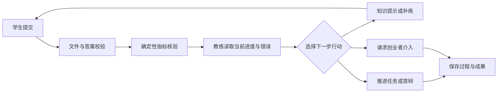

# 項目需求總覽（接手入口）

整理日期：2026-11-04。此文件歸納已有設計，不代表本次重新驗證程式。詳細規則以各原始方案及後續已確認變更為依據；有衝突時先核對日期和實作，不自行推定需求變更。

## 新方向：Java 後端學習至模擬實習（討論中）

更新：2026-11-05。以下記錄使用者已確認的方向與流程，並補充標為「建議」的實作與驗收細節；尚需實際驗證與使用者驗收。此節中已確認變更取代下方舊方案中與之衝突的產品方向；舊方案保留作歷史依據，並非新功能已實作。

- **第一版容量**：先按一名學生使用及提交規劃；不宣稱支援多人同時檢查，實際伺服器能力待測。
- **目標**：面向沒有基礎的學習者，以清楚的崗位學習路線減少選擇資料的焦慮，從自行學習走到網站內模擬公司的工作實訓；不承諾提供真實公司實習。
- **崗位**：第一版顯示 Java 後端工程師，參考中國內地實習崗位；後續崗位以使用者提供的 `2027校招信息匯總 (1).xlsx`「軟件工程相關崗位」為範圍，順序待定。現有銷售分析和軟體工程實訓入口先隱藏，保留程式與學生資料。
- **路線**：以使用者提供的九項內容為基礎：Java 基礎、Java 進階、Git、MySQL、Java Web、業務項目與 Redis、Linux、Docker、測試與安全。具體章節與資源待核實。資源須免費、中文且內地可訪問；英文官方文件僅作候選參考，例外未確認。網站提供路線和外部資源，學生到外站學習；可逐個影片或文章自行標記已完成，供下次查看並繼續學習；標記不視為能力通過。
- **流程**：不設階段小測驗或階段解鎖，已有基礎者可以跳過已掌握內容。完成學習後參加不同於商店場景的綜合實作（如比賽管理系統，具體題目待定）；平台提供已有部分程式的起始項目，學生完成剩餘功能，在自己電腦編程，上傳平台檢查，通過才進入模擬實習。綜合實作除檢查後端功能與功能測試，也檢查學生自己寫的測試、程式結構及學生對設計的解釋；通過原則：核心功能及學生自己寫的測試必須通過；程式結構與設計解釋可有不足，但滿分 100 分中總分須達 70 分；兩項必要條件未通過時即使總分達標也不能通過。各項權重、學生測試有效性及評分方法待定。
- **模擬公司**：接手已有部分程式的網上商店，圍繞同一項目逐步完成所選崗位職責內的 Java 後端任務。第一版核心任務為查詢商品、建立訂單、查看訂單；起始項目已有功能、任務細節與逐項驗收條件待定。第一版由平台列出任務；AI 同事／導師屬後續設想，具體版本待定。
- **檢查與回饋**：第一版採本機開發、上傳後平台短暫檢查的方向，伺服器容量、安全隔離與 Java 相容性仍待驗證。先顯示實際檢查結果，學生按需請 AI 解釋；學生學習期間也可主動向 AI 提問。每位學生每天 AI 提問和檢查結果解釋共用 10 次，第二天自動恢復，第一版不額外增加。具體重置時區及失敗請求計算待定。
- **機會**：綜合實作及每項模擬實訓任務第一版各限三次有效檢查；服務器或檢查環境故障而無法完成不計次。三次未通過先複習，再由教師或管理員重設。何種輸入錯誤、重置次數及授權細節待定。
- **待確定**：最終題目與通過標準、具體商店任務、資源逐項核實、第一批交付範圍、伺服器與隔離執行驗證、長篇影片按整套或逐小節標記進度（暫緩討論）；資源失效後如何更新依使用者意願暫不討論。

### 開發者工程選擇（2026-11-05，第二批，待使用者確認）

以下是為了把方向落成可操作初版而做的**工程選擇**，不是使用者已逐項確認的產品決定；驗收時可調整。

| 項目 | 本次選擇 | 理由與影響 |
| --- | --- | --- |
| 綜合實作題目 | 比賽報名系統（Java，JDK 內建功能） | 與商店不同場景；無外部套件，檢查可完全離線 |
| 起始專案形式 | 學生下載 ZIP，本機以 `javac`／`java` 執行；提供 CLI 示範與規則文件 | 不需要 IDE 或建置工具；上傳整個專案 ZIP |
| 綜合實作評分（100） | 核心功能 45、學生測試 20、程式結構 20、設計解釋 15 | 核心與學生測試為必要條件；總分至少 70；設計解釋未評分可通過並標示待評 |
| 必要條件判定 | 核心 9 項全過 且 學生測試「正確版不誤報＋抓出三個內建故障」全過 | 只用程式實際執行結果，AI 不參與 |
| 程式結構評分 | 四項靜態檢查：使用注入 Clock、單檔≤400 行、無空 catch／printStackTrace、無可變 static 集合 | 可重現、可解釋；不代表完整可維護性評估 |
| 設計解釋評分 | 學生主動請 AI（三項各 0–5）或教師人工評分 | 使用共用每日額度；2026-11-05 使用者已確認必須評分才算通過（見下節），原「未評分不阻擋通過」作廢 |
| 商店三項工作 | 查詢商品、建立訂單、查看訂單；HTTP JSON 介面固定；附可直接操作的前端頁 | 學生只寫後端 `ShopService`，不需完成前端 |
| 解鎖順序 | 綜合實作通過 → 查詢商品 → 建立訂單 → 查看訂單 | 與已確認流程一致；不設階段小測驗 |
| 檢查執行 | Docker、無網路、唯讀掛載、非特權使用者、資源上限；同步請求 | 單學生規模；未建非同步佇列與多學生容量承諾 |
| 次數 | 每項工作 3 次有效檢查；環境故障不計次；教師（限本班）或管理員重設 | 重設保留歷史，不刪除提交與結果 |
| AI 角色 | 只解釋實際檢查結果、評分設計解釋；主動點擊才呼叫；共用每日 10 次 | 不自動呼叫、不改通過判定 |

### 2026-11-05 使用者已確認的規則變更

- **設計解釋必須評分才算通過**：綜合實作的設計解釋（0–15 分，可以為 0 分）在完成評分前，即使其他項目合計已達 70 分，也不能通過。通過仍要求核心功能全部通過、學生自己寫的測試全部通過、總分至少 70/100。AI 不可用時由教師人工評分。此決定取代上表「設計解釋未評分可通過並標示待評」的工程選擇。

### 第一版驗收草案

以下是根據已確認需求提出的驗收細節；具體技術實現和各評分項權重待驗證，不能用草案冒充現有功能已完成。

1. 學生登入後只看到 Java 後端路線；原銷售分析與軟體工程入口隱藏，既有程式及學生資料保留。
2. 路線按九項主題呈現已核實的免費中文外部資料，標明來源；學生可跳過主題，逐項標記資料完成，重新登入後保留。長影片按整套或小節記錄待討論。AI 答疑與檢查結果解釋共用每人每天 10 次，耗盡後第二天恢復。**建議**以中國時間重置並顯示剩餘次數；模型失敗／計費邊界需依實際服務確認。
3. 學習階段不設小測或解鎖限制；學生可進入綜合實作。平台提供不同於商店的部分完成起始項目，學生本機完成並上傳。核心功能和學生自寫測試均須通過、總分至少 70/100，才可進入模擬實習。**建議**用預設故障案例檢查學生測試是否真正有效；結構及設計解釋的評分方式、權重、人工複核與 AI 費用待定。
4. 模擬實習接手有部分程式的網上商店，提供可在本機操作的前端，第一版完成商品查詢、建立訂單、查看訂單三項後端工作。**建議**先讓學生在本機操作，服務器只在上傳後短暫檢查；前端可運行情況與 Java 執行資源待驗證。
5. 綜合實作及每項實習任務各限三次有效檢查；故障導致檢查未完成不計次。三次未通過先複習，再由教師或管理員重設。先顯示檢查結果，AI 解釋須學生主動請求；禁止把環境故障或 AI 建議當作實際檢查通過。

資源核查須檢查連結、中文、是否免費和中國內地訪問條件；現有清單「網站已有」及實際部署狀態均未本輪核實。資源失效的更新流程暫緩。Java 實作未驗證，既有檢查器不代表已支援 Java。

## 目標與使用者

提供大學生可操作的崗位實訓：用具體任務、證據、反饋和獨立測評幫助學習；教師可查看獲授權的學習證據和安排補練；創業者可管理學員與人工復核。開發者演示不等於真實學生效果。

## 已記錄的範圍與流程

- 學生註冊或登入 → 項目庫選擇實訓 → 起點診斷 → 分階段完成任務與反饋 → 答辯、獨立遷移 → 查看和交付作品。各項目進度分開。
- 銷售數據分析：清洗和核驗資料、分析指標、圖表與報告；詳細規則與驗收見 [原始產品方案](#req-retail)。
- 軟體工程：閱讀並修復活動報名系統、上傳版本、接受檢查、報告及答辯，再處理候補變更；詳細範圍與驗收見 [軟體工程方案](#req-engineering)。執行環境依賴 Docker。
- 教師建立班級，學生確認加入；教師按項目查看授權證據、提出補練草案並確認發題、查看作品和人工復核。班級不限制學生選擇項目，見 [教師方案](#req-teacher)及[班級變更](#req-classes)。
- AI 依授權的材料與工具提供反饋；客觀核驗由程式進行。模型失敗與未配置時須如實顯示，不能當作已完成評價。首次登入教程及個人化補練見 [教程方案](#req-tutorial)及[個人化實作](項目進度與交接.md#progress-personal)。教程早期方案中的待批准狀態已由後續[部署記錄](項目進度與交接.md#progress-deployment)更新。

## 核心驗收條件

學生可分別完成兩項實訓的主要流程並保留本人進度；不同帳號及項目資料隔離；教師只能依授權查看與操作；作品、評價和檢查能對應材料版本；AI 失敗不冒充成功。詳細逐項條件與人工案例見各方案、[驗收記錄](verification.md)及[教師驗收](teacher-workspace-manual.md)。這些是要求，不是本次通過聲明。

## 範圍邊界與待確認

原方案以本機及小規模試用為主要背景；軟體工程方案把完整瀏覽器 IDE、任意外部依賴與其他語言路線列在當時範圍之外。未找到最新經確認的整體 V2/V3 需求，後續方向待定。比賽、部署及真實試用的現況需重新核對，不能僅依舊文件斷言。


## 已確認決定與歷史變更索引

| 主題 | 應採用的歷史決定與依據 | 狀態及關係 |
| --- | --- | --- |
| 銷售分析 | [原產品方案](#req-retail)記錄完整學生流程與驗收條件 | 歷史授權的核心範圍；實際目前是否可用待重驗。 |
| 多項目 | [軟體工程方案](#req-engineering)記錄第二項實訓、版本隔離和 Docker 邊界 | 文件記錄已授權並寫入；完整人工驗收待確認。 |
| 教師與班級 | [教師方案](#req-teacher)及[班級不再綁定項目](#req-classes) | 後者是後續確認的變更，取代舊班級綁定單一項目的描述；各項目證據仍分開。 |
| 教程 | [教程方案](#req-tutorial)與[後續部署記錄](項目進度與交接.md#progress-deployment) | 早期「待批准／未載入」只描述當時；後續已批准並寫入，人工驗收仍待確認。 |
| 個人化 | [個人化方案](#req-personal)與[實作狀態](項目進度與交接.md#progress-personal) | 歷史批次 A 已寫入；B、C 當時仍是方案，不等於已確認的新版本。 |

歷史資料中的任務勾選、服務地址、帳號和授權只反映當時；實際狀態以新的核對結果為準。尚無證據可將歷史提案自動視為現行需求。

## 歷史資料整合

以下保留原文件內容以供追溯；其中日期、勾選和狀態均是當時紀錄，與本文件開頭的接手狀態一併閱讀。


---

<a id="req-retail"></a>
### 原文件：docs/superpowers/specs/2026-10-11-ai-career-training-design.md

# 实战起点：AI 岗位实战训练营——产品与实施方案

版本：实施依据 v1.2。创建日期：2026-10-11。更新日期：2026-10-12。

本文件交付产品设计、技术边界、实施顺序与验收标准。用户已授权在完善并检查方案后开始开发，并明确保留六个阶段的完整核心交付。竞赛要求和评分权重以用户提供的文字及截图为依据，未独立核验完整赛事通知。用户之后提供模型服务 API key，开发阶段完成真实接口与自动测试；真实模型质量和真实学生试用须分别取得实际证据。

## 1. 产品定位

**一句话：帮助大学生通过实际任务、针对性反馈和成果答辩，完成一份有过程证据的岗位实训作品。**

- 首批用户：学过基础 Excel、尚未做过完整分析项目、准备申请实习的大学生。
- 首个岗位方向：运营数据分析入门。
- 首个项目：模拟校园文创店的销售分析与运营建议。
- 产品形态：桌面浏览器优先的可操作网站；手机支持查看进度和反馈，表格处理建议在电脑完成。
- 学生交付：指标表、图表、分析报告、答辩回答、修改记录。
- 创业者交付：一套可重复服务多位学生的实训包及运营后台。

教育目标是判断学生能否理解、计算、解释和迁移，不以报告是否写得漂亮作为唯一标准。真实需求、付费意愿和教育效果均需试用验证。

## 2. 第一版的范围

### 必须完成

1. 一个完整实训包，包含任务、数据字典、验收标准、知识卡片和补练题。
2. 能力诊断及个性化任务安排。
3. 模板下载、CSV 提交、结构化答案输入和版本记录。
4. 程序核对指标，AI 解释错误并选择补练。
5. 根据本人作品展开的文字答辩。
6. 作品集预览、HTML 与 Markdown 下载；HTML 支持浏览器打印为 PDF。
7. 邀请制学生账号、创业者后台及基本使用统计。
8. AI 不可用时仍能完成基础任务、获得规则反馈并导出作品。

### 后续扩展

新媒体运营等其他岗位、语音答辩、自由代码执行、真实企业项目、自动抓取招聘信息、支付、小程序、企业招聘评价。第一版不把这些纳入完成标准。

## 3. 首个实训项目

### 项目委托

模拟校园文创店提供连续 8 周的交易数据。学生比较前 4 周和后 4 周的净销售额，识别变化最大的品类和渠道，提出两项有数据依据、可验证的运营建议。

数据只能支持描述性分析与假设。学生不能把品类变化直接表述为因果关系，也不能在缺少成本数据时得出利润结论。

### 数据方案

第一版使用自行制作的固定合成训练数据，明确标注“模拟数据，不代表真实店铺经营”。准备训练数据 A 和独立迁移测评数据 B，分别有 8 个完整周，数据种子、版本、文件摘要和参考计算结果固定。

- 每份约 500 条有效订单，覆盖 4 个品类、2 个渠道。
- 每条记录代表一笔单品订单，避免把订单行数和订单数混用。
- 在有效订单副本中额外插入 5 条完全重复记录、3 条必填字段缺失记录，用于数据质量训练；数据说明明确为教学设计。
- B 更换销售结构与退款分布，不能仅通过记住 A 的答案完成。
- 数值生成后通过独立计算和小样本手算复核，不让语言模型生成标准答案。

| 字段 | 定义与约束 |
|---|---|
| order_id | 单品订单唯一标识；完全重复行仅保留首次出现的一行 |
| order_date | 日期 YYYY-MM-DD；两个比较窗口分别包含 28 天 |
| category | 四个预先定义的品类之一 |
| channel | 线上或线下 |
| quantity | 正整数 |
| unit_price | 人民币单价，非负，最多两位小数 |
| refund_amount | 同一订单在本教学快照内的退款额，范围 0 至订单毛销售额 |

固定数据处理口径：先按全部字段删除完全重复行；再隔离必填字段缺失、非法日期、非法数值和重复编号内容冲突的记录。隔离记录不计入教学分析，但必须在报告中说明数量及影响，不允许自行编造缺失值。模拟数据不会混入跨期退款；该限制写入数据字典。

指标定义：

- 毛销售额 = quantity × unit_price。
- 净销售额 = 毛销售额 − refund_amount。
- 净客单价 = 净销售额总和 ÷ 纳入分析的订单数，包括全额退款订单。
- 金额退款率 = 退款额总和 ÷ 毛销售额总和。
- 变化率 =（后 4 周值 − 前 4 周值）÷ 前 4 周值。
- 基期为零时显示“不可计算”，不能给出无穷大或默认 0%。
- 比率在提交模板中统一使用百分数，如 12.50 表示 12.50%；金额单位为元。
- 金额使用整数分进行关键计算；金额允许误差 0.01 元，比率允许误差 0.01 个百分点。计算过程保留精度，展示时再舍入。
- 品类贡献先比较两个窗口的净销售额绝对差值，再描述变化，不要求把所有负贡献强行归一为 100%。

可在后续增设公开数据项目。例如 UCI Online Retail 含交易、数量、价格与取消信息，数据页标示 CC BY 4.0。使用时保留原币种及真实背景，说明出处和预处理，不称其为校园店铺数据。该数据不是第一版的必需依赖。[UCI 数据页](https://archive.ics.uci.edu/dataset/352/online%2Bretail)

## 4. 学生使用流程

| 阶段 | 学生操作 | 系统执行 | 可观察结果 |
|---|---|---|---|
| 诊断 | 完成 6 个小题：单位、退款、重复、图表、证据、因果 | 记录技能标签；安排基础或直接实战路线 | 个性化任务板 |
| 数据检查 | 下载 A，用表格工具检查后提交清洗后的 CSV 及处理说明 | 检查字段、订单集合和隔离记录 | 具体问题及可执行反馈 |
| 指标分析 | 下载指标模板，提交两个窗口和分组结果 | 与服务端参考结果逐项对照 | 正确项、错误类型、下一步练习 |
| 图表与结论 | 选择已提交指标对应的图表，写观察、依据和建议 | 检查图表数据来源；教练点评推理 | 可追溯结论及修改建议 |
| 成果答辩 | 回答 3 个基础问题及最多 2 个追问 | 引用作品中的事实进行追问 | 回答记录及教练意见 |
| 迁移测评 | 独立完成 B 的简化分析，不接受针对答案的提示 | 使用相同客观口径核验；作答结束后反馈 | 与前测可比较的成绩 |
| 作品交付 | 查看、修订自己的说明，确认导出 | 汇总本人作品、反馈和过程 | 下载成果包 |

训练任务不是一次性生成长篇计划。任务板根据已发生的错误和补练结果更新；完成同类错误的补练后再回到原任务。

### 交互例子

学生把毛销售额当作净销售额提交。系统检测到答案匹配“未扣退款”的常见错误模式。Agent 选择退款知识卡片和一笔订单的练习，让学生重新计算，再回到主任务提交修正版。系统记录错误、提示等级、补练结果及新版本的核验结果。

## 5. Agent 的实际实现

第一版采用一个教练 Agent、明确的任务状态和少量受控工具。教练可根据证据选择行动，服务端负责校验和执行。

### 5.1 API key 如何接入 AI

产品使用用户提供的模型服务 API key 调用外部大语言模型。API key 不是 Agent 本身；Agent 是我们开发的任务控制、工具、知识、记忆和模型调用程序。

接入方式：学生在网页提交 → 我们的 Python 后端读取服务端环境配置 → 携带 API key 调用模型服务 → 接收模型的工具调用或结构化回复 → 后端校验并执行工具 → 将结果交还模型 → 保存反馈并返回网页。学生浏览器不直接调用模型服务，也不接收密钥。

配置包含 AI_API_KEY、AI_BASE_URL、AI_MODEL、可选 AI_INPUT_PRICE_PER_MILLION 和 AI_OUTPUT_PRICE_PER_MILLION。AI_BASE_URL 为供应商的兼容接口根地址，后端调用其 chat/completions 接口；AI_MODEL 必须是该供应商账号可用、支持工具调用的模型。具体供应商和型号在用户提供连接信息后配置。密钥由用户在本机 .env 或部署环境变量中配置，文件不提交到源代码或参赛材料。我们不在没有密钥时声称已经真实调用模型。

阿里云百炼官方说明了工具调用流程：模型返回工具名和参数，应用执行工具，将结果交还模型，再获取反馈。实际接入仍按所选供应商文档验证兼容性。[Function Calling 官方文档](https://help.aliyun.com/zh/model-studio/qwen-function-calling)

### 5.2 六项 AI 职责与实现

| 职责 | 送给 AI 的信息 | AI 的决策或输出 | 后端如何落实 |
|---|---|---|---|
| 起点诊断与路线 | 诊断答案、正确性、学生自述、技能标签、任务依赖 | 解释知识缺口，选择先补基础或进入实战 | propose_next_task 仅在允许范围内安排任务，记录路线理由 |
| 错因诊断与辅导 | 当前提交、程序核验的问题、计算口径、此前错误 | 区分概念、口径、计算和证据问题；选择提示与补练 | lookup_skill_card 和 assign_remediation 获取已审核内容，保存练习任务 |
| 分析报告审阅 | 学生原文、已核验指标、报告引用、评价量表 | 找出缺少证据的结论、过度因果推断，给出具体修改意见 | review_report 保存逐项评价及证据；客观数字仍由程序核验 |
| 作品答辩 | 固定作品快照、本人结论、已答内容、薄弱技能 | 生成针对本人作品的追问，并评价解释是否成立 | ask_defense_question 保存问题；review_defense 保存训练评价 |
| 作品整理 | 已完成任务、本人文本、核验状态、版本、AI 使用记录 | 提出结构和措辞改进，引用已有证据 | build_portfolio 生成预览，学生确认后导出；不添加新经历 |
| 创业者运营助理 | 授权范围内的匿名学员进度、错误分布、人工时间及模型用量 | 指出需要介入的学员，提出课程改进建议 | operator_insights 只读汇总；不能自动联系学员或更改收费 |

上述是同一产品内的职责模块，可以复用一个模型。各模块有自己的提示模板和可用工具，不要求部署六个模型或六个互相聊天的 Agent。

### 5.3 一次真实 Agent 调用的步骤

1. 后端先验证提交，保存不可覆盖的提交版本，并运行客观核验。
2. 构造上下文：当前任务、相关学生记忆、当前核验事实、课程口径、允许的工具。只发送必要片段。
3. 根据用途选择提示模板：诊断、辅导、报告审阅、答辩、作品整理或运营汇总。声明学生内容是待分析材料，不是系统指令。
4. 向模型 API 发送 messages 与 tools。模型可选择工具，或直接返回符合输出结构的意见。
5. 后端校验工具参数、资源归属、任务依赖及证据编号，执行允许的操作；无效调用返回可修正错误，不能绕过权限。
6. 将工具结果与对应工具调用编号交还模型，允许继续选择工具或生成反馈。单次事件最多三轮工具循环，之后停止并保存现有结果。
7. 验证最终回复包含 message、evidence_ids 和 needs_human_review。引用不成立或结构无法解析时不执行副作用，转基础反馈或人工复核。
8. 保存模型标识、用量、耗时、动作、反馈、所引用提交版本及当前任务变化，网页显示结果。

例如：退款计算错误 → AI 查阅退款知识卡 → AI 安排对应补练 → 后端保存补练任务 → AI 按学生先前表现解释 → 学生作答 → 再次客观核验 → AI 判断回到主任务或继续提示。该循环跨多次学生操作持续，不以一篇生成的长计划作为完成结果。

### 5.4 Agent 的知识与记忆

- 课程知识：人工维护的指标定义、数据字典、知识卡、题目和评分标准，按技能编号与关键词检索。初版范围小，不依赖向量数据库；知识内容的版本与来源可追溯。
- 长期记忆：数据库保存诊断、技能标签、已通过任务、错误类型、提示等级、补练完成情况、提交版本和答辩回答。重新登录后继续同一学习路线。
- 当前上下文：每次调用只加载当前任务和相关记忆，课程标准优先于自由对话摘要。技能掌握必须有任务证据，不由模型凭印象认定。
- 学生内容和模型总结不能成为账号权限、通过条件或系统提示。参考答案只在核验服务使用；教学反馈使用符合提示等级的事实摘要。

### 5.5 提示模板与输出验证

每个模板明确角色、教育目标、输入事实、允许工具、引用要求、禁止事项及输出结构。报告与答辩的主观量表来自第 6 节；学生原文和模型建议分开保存。模型可建议改写，学生确认后才能采用。

后端接受的 AI 评价必须引用实际存在的证据，分值在量表范围内，每项附理由。AI 输出格式正确只证明接口可解析，不证明教学正确；20 条固定案例和人工抽查分别验证决策与教学内容。

### 5.6 未提供密钥时与验证边界

未配置密钥：网页标为基础训练模式，客观核验和知识卡正常使用，不生成虚构的 AI 日志或 AI 分数。开发通过模拟 HTTP 模型服务测试完整工具循环、用量记录、错误响应和权限约束；该测试不算真实供应商测试。

提供密钥后：运行连接测试，确认模型、工具调用和结构化回复可用，再运行固定教练案例，记录延迟及实际费用。真实学生试用单独记录；开发者测试账号不能计入实际用户成效。



### 允许调用的工具

| 工具 | 用途 | 权限边界 |
|---|---|---|
| inspect_submission | 获取当前提交的结构和核验问题 | 仅当前学员、当前任务 |
| check_metrics | 运行预定义指标核验 | 参考答案在服务端；面向学生的结果遵守提示等级 |
| lookup_skill_card | 按技能编号读取课程知识卡 | 只检索维护的知识卡及来源 |
| assign_remediation | 选择已编写的补练及提示等级 | 不生成未经校验的数学标准答案 |
| propose_next_task | 根据诊断、成绩及补练提出下一任务 | 后端检查依赖和允许的状态转换 |
| ask_defense_question | 基于已提交作品提出追问 | 最多 5 个问题，不能声称验证真实工作经历 |
| request_human_review | 将证据不足、重复失败或申诉交给创业者 | 带原因和提交版本，不能擅改成绩 |
| build_portfolio | 汇总已有成果 | 不能新增未完成经历或未验证数值 |
| review_report / review_defense | 保存有原文及事实依据的主观评价 | 分值由服务端校验范围，不覆盖客观分数 |
| operator_insights | 向创业者提供匿名运营汇总建议 | 创业者账号专用，只读汇总 |

工具决策使用 tool_calls（工具名和参数，例如 skill_id、hint_level），最终反馈 JSON 使用 message、evidence_ids、needs_human_review。后端验证工具名、参数、用户资源权限和流程状态后执行；执行结果保存后，再决定下一步。每次学生操作最多 3 轮教练行动，超过即结束该轮并给出可继续的状态。

客观指标的执行、成绩与推进权限由程序控制。模型不能直接修改数据库、执行任意 Python/SQL、联网搜索或读取其他学员内容。

### 任务状态与版本

任务状态包括未开始、进行中、已提交、需要修改、已通过、待人工复核。每次提交产生不可覆盖的版本。反馈、评分、图表和作品引用明确版本；修改上游数据后，下游依赖标记为“需要重新核验”，直到引用最新已通过版本。答辩开始后绑定作品快照，避免问题与作品变化失配。

### 分层提示

1. 概念提示：提示应考虑退款、单位或重复等问题，不给出当前任务答案。
2. 定位提示：指出具体字段或步骤。
3. 示范提示：展示独立小样本的计算，然后要求学生完成原任务。

提示次数和等级进入过程记录。申请查看完整参考解答可作为训练功能，但必须标记，并不能用于迁移测评得分。

## 6. 评分和完成规则

评分分为 **客观核验 60 分** 和 **教练评价 40 分**，并分别展示。

| 内容 | 分值 | 评价方式 |
|---|---:|---|
| 数据处理 | 20 | 重复处理、隔离处理、有效订单集合、处理计数，4 项各 5 分 |
| 指标计算 | 25 | 两个窗口净销售额、变化率、后期净客单价、后期金额退款率，5 项各 5 分 |
| 图表数据依据 | 15 | 两窗口品类表、渠道表、8 周趋势表，3 项各 5 分 |
| 业务解读 | 25 | 观察与假设区分、证据、建议可执行性、验证方法、限制说明，5 项各 5 分 |
| 成果答辩 | 15 | 指标理解、方法解释、限制理解，3 项各 5 分 |

三项客观分组中的任何一项未通过，都进入需要修改；主项目完成要求客观核验达到 60/60，报告已提交且至少包含两项绑定证据的建议，基础答辩已作答，迁移测评已完成。学生可导出尚未完成的作品，但显示“进行中”及未通过项。

主观评分为训练建议，不是职业资格认证。每项给出判断依据和原文引用；证据不足标记“待复核”，不强行打分。创业者可复核并保留原评价、调整理由和时间。

当模型不可用时，客观部分照常评分；报告和答辩显示“尚未提供 AI 评价”，不能用固定分数冒充完整评价。

## 7. 页面与交互

| 页面 | 主要内容 | 主要动作 |
|---|---|---|
| 产品入口 | 适用学生、项目内容、预计练习量、模拟实训说明 | 输入试用账号、开始训练 |
| 起点诊断 | 6 个基础问题及结果 | 完成诊断、查看路线 |
| 任务工作台 | 左侧任务阶段，中间提交区，右侧教练反馈 | 下载数据、提交、补练、继续 |
| 分析报告 | 数据来源、图表、结论、依据、建议、限制 | 编辑及引用已有指标 |
| 成果答辩 | 当前作品快照、提问、作答记录 | 文字回答、继续追问 |
| 作品集 | 成果、客观核验、教练意见、迁移表现、协作记录 | 预览、下载、选择性分享 |
| 创业者后台 | 学员进度、复核队列、成本、服务时间 | 复核、记录介入、管理实训包 |

任务工作台是产品的中心。教练反馈依附于提交和任务，不设置与实训无关的开放聊天入口。

作品集至少包含：模拟实训声明、项目背景、数据来源与版本、本人提交的表格和结论、图表、核验记录、修改摘要、答辩节选、迁移结果、AI 协助范围。AI 改写必须由学生预览确认；保留原文，不让 AI 自动增加个人经历。

## 8. 技术方案

建议采用 React + TypeScript + Vite 作为浏览器前端，Python + FastAPI 作为后端，pandas 处理受控表格，SQLite 保存小规模试用数据。React 官方提供 Vite 等工具的构建路径；FastAPI 支持类型化接口和输入校验；pandas 提供 CSV、分组和表格处理能力。实际开发时锁定依赖版本并保留依赖清单。

- 前端：路由、任务板、表单提交、图表、作品预览；图表只引用服务端确认的表格数据。
- 后端：账号与资源权限、提交解析、指标核验、任务推进、教练调用、作品导出。
- 存储：SQLite 位于持久化磁盘；提交文件放在非公开目录，下载必须鉴权。公网试用采用单实例并对写入做短事务处理。
- AI：通过服务端模型适配层接入一个支持所需能力的模型服务。实际使用的供应商、模型标识、调用方式与日期进入来源清单。上线前用课程测试集评估后固定配置，不宣称默认本地运行或开源。
- 知识内容：课程任务、错误类型、知识卡、补练题和判分口径以版本化配置维护。
- 导出：模板生成 HTML 与 Markdown；浏览器打印为 PDF，第一版不建设复杂文档生成系统。
- 部署：单台服务器持久化运行后端与前端静态资源，提供 HTTPS；同时保留本机启动方式供比赛现场使用。

官方参考：

- [React 构建文档](https://react.dev/learn/build-a-react-app-from-scratch)
- [FastAPI 文档](https://fastapi.tiangolo.com/)
- [pandas 概览](https://pandas.pydata.org/docs/getting_started/overview.html)

### 数据实体

实现采用 users、states、sessions、shares、operations 五张 SQLite 表。states 按学生以 JSON 保存诊断、路线、任务进度、submissions、evaluations、agent_runs、defense、work_history 和 human_reviews；课程实训版本由 course.py 管理。shares 保存主动分享快照，operations 保存成功请求的重试响应。并非每个逻辑实体都有独立数据表。

### 后端模块边界

账号与权限、课程配置、提交处理、指标核验、流程引擎、模型适配、教练工具、答辩、作品导出、运营统计分别独立。指标核验和流程引擎不依赖语言模型，能够单独运行与测试。

## 9. 稳定性、权限与数据来源

这些要求直接落实到产品及验证，不在界面展示冗长技术说明。

- 上传只接受 UTF-8/带 BOM 的 CSV，最大 2 MB、10,000 行；错误定位到字段和行。第一版不解析上传的程序、压缩包或宏文件。
- 文本单次最多 4,000 字，内容作为学生材料处理。出现“忽略规则”等文字不能变为系统指令；工具调用继续执行权限校验。
- 每次提交带幂等标识，重复点击复用已有处理状态，不启动并发重复模型调用，不重复推进流程。自动重试产生的用量据实记录；供应商可能对超时请求计费，系统不承诺超时调用免费。
- 每次供应商请求设 30 秒网络超时，可额外重试一次；多轮事件总时长可能超过 30 秒。结构无效或最终回复失败时不提交草稿副作用，真实调用记录保留。
- 教练失败后保留提交，给出规则反馈及稍后重试入口。基本训练模式和 AI 教练模式清楚标示；迁移测评也记录当时模式。
- 模型密钥只保存在服务端，不进入网页和作品集。日志不记录密钥，不向模型发送密码或无关账号信息。
- 学生只访问自己的提交、成绩和作品；创业者访问权限与普通学生分离。
- 分享作品需主动创建可撤销链接，默认不包含原始上传和私人答辩内容。
- 试用账号由创业者创建，密码使用 Python 标准库 scrypt 加随机盐保存为哈希；学生退出、账号删除和管理员复核均有权限校验。
- 自主删除账号后删除关联提交、私人过程和作品分享；当前本机不自动备份；提供手动备份和新目录恢复工具。每次执行备份时轮换七天前文件，无人执行时不会自动清除。管理员须处理删除请求涉及的手动备份。
- 数据、模型、课程资料、开源依赖和 AI 辅助开发分别记录出处及实际用途；自行生成的数据保留生成规则。

## 10. OPC 经营设计

创业者负责设计实训包、招募学生、抽查评价、处理异常和改进服务。Agent 负责重复性的诊断、检查、反馈、补练安排与作品整理。

后台必须回答：

1. 谁卡住了，卡在哪个技能，需要我做什么？
2. 一名学员消耗多少模型调用及费用？
3. 我为一名学员投入了多少人工时间？
4. 哪个任务反复出错，是否需要修改课程？
5. 学员是否完成、是否愿意参加下一个项目？

模型有用量字段时据实保存；没有时显示“用量未知”。费用按试用时实际费率估算，并与账单核对。人工时间由创业者记录，不把系统等待时间当人工时间。

首批商业验证采用免费诊断和一个完整实训包的付费意愿调查，也可在获得客户明确同意后开展真实收费试点。第一版无需支付集成。调查意愿、实际付费和收入分别统计，不能混用。

粗略核算：单学员贡献 = 实收金额 − 模型费用 − 分摊服务器费用 − 按明确时薪折算的人工服务成本。课程设计与获客时间另列，不能由单次贡献直接推导经营利润。

## 11. 实施阶段与交付标准

这是按依赖关系排列的开发路线；每阶段通过验收再进入下一阶段。可作为约 6 个工作阶段安排，实际用时取决于开发与内容验证，不是承诺六周完成。

| 阶段 | 主要工作 | 阶段结束能展示什么 |
|---|---|---|
| 1：实训内容与核验基线 | A/B 数据、数据字典、指标模板、手算小样本、评分标准、知识卡与补练 | 无 AI 也能判定提交正确与否 |
| 2：学生训练流程 | 账号、诊断、任务板、下载上传、状态与版本 | 学生可以从诊断走到指标核验 |
| 3：教练 Agent | 模型适配、受控工具、分层提示、补练、失败回退 | 两种不同错误触发不同下一步 |
| 4：作品与答辩 | 图表引用、报告编辑、作品快照、答辩、导出、迁移测评 | 完整运行一个学生实训闭环 |
| 5：创业者运营 | 复核队列、进度与成本统计、人工时间、来源清单 | 一个创业者管理多名学员 |
| 6：试用与参赛 | 邀请试用、评价抽查、修复、现场演示数据、备份启动、材料整理 | 可访问产品、真实试用证据和可重复演示 |

最先实现的完整切片：学生提交指标 → 程序检测未扣退款 → 教练安排退款补练 → 学生修改 → 保存通过记录。随后扩展整条路线。

## 12. 验证计划

### 必须通过的功能验证

- 小样本手算结果与核验一致，包括退款、重复、零基期和边界舍入。
- 正确 CSV 通过；错单位、漏退款、缺列、错误编码和超限文件给出具体反馈。
- A 的答案不能直接通过 B 的核验。
- 未通过任务不能被 Agent 擅自标记通过。
- 重复提交不启动并发重复模型调用；超时重试费用据实记录；模型超时和返回非法结构不重复推进任务。
- 刷新或服务重启后继续已有进度，提交版本不丢失。
- 修改上游数据后，下游报告显示需要重新核验；导出不混入旧版结论。
- 学员之间不可访问对方文件、答辩和作品；匿名访问后台被拒绝。
- 作品和模型日志不暴露参考答案、密钥及无关私人资料。
- AI 断开后，基础训练可继续，评价状态和模式标识真实。

### 教练质量验证

准备 20 条固定测试案例，覆盖漏扣退款、单位误读、错误去重、证据不足、因果过度、无成本却判断利润、提示注入及模糊答辩。检查是否引用正确事实、是否选择适当补练、是否捏造信息。客观错误必须由核验器全部检测；教练反馈至少 18/20 符合事先定义的评价表，其余转人工或修正后再上线。样本通过不等于证明所有情况可靠，保存失败案例。

## 13. 教育效果与用户验证

目标招募 10–20 名与定位相符的学生，数字为招募目标，不能写成已有用户。

- 起点诊断使用 6 道独立短题 C，结业使用同难度的 6 道短题 D；不同学生交叉使用 C/D 作为前后测，降低题目难度差影响。诊断结果决定训练路线，前后测客观得分单独保存。
- 前后测不提供针对答案的 AI 提示，不以重复同题提高分数证明学习。
- B 是完整迁移任务，记录独立正确率、用时及所用外部帮助的自报情况。
- 保存完成率、退出阶段、关键错误修正率、提示次数、复核比例、人工时间和服务成本。
- 用统一量表人工抽查结论质量；保存分歧和调整记录。
- 收集“是否愿意参加第二个项目”和付费意愿，并与实际付费区分。

小规模试用可提供可用性及初步学习迹象；没有对照组时，不宣称已证明优于教师辅导或显著提高就业率。展示匿名样例，公开作品须取得学生同意。

## 14. 五分钟现场演示

| 时间 | 操作与展示 |
|---|---|
| 0:00–0:40 | 描述目标学生，展示任务委托和已完成诊断的演示账号 |
| 0:40–1:40 | 现场提交预置错误指标 CSV，显示程序检测出的漏扣退款问题 |
| 1:40–2:40 | Agent 实际选择并展示退款补练，评委回答一题 |
| 2:40–3:30 | 提交预置修正版，展示通过记录与不同版本 |
| 3:30–4:20 | 打开明确标注为预置的完整作品，现场回答一个基于该作品的追问 |
| 4:20–5:00 | 导出成果，打开创业者后台展示进度、调用成本与人工复核 |

完整学习过程不在五分钟内伪装完成。预置作品和历史过程标注为演示样例；现场动作真实执行。网络异常时展示基础模式，不把缓存文本伪称为即时 Agent 生成。演示视频只作备用，与可操作产品一并准备。

## 15. 参赛材料和评分对应

| 评分维度（用户提供） | 产品证据 |
|---|---|
| 场景适配性 20 | 用户访谈、明确岗位与能力目标、任务委托 |
| 技术规范性 25 | 核验测试、权限验证、来源清单、故障回退、可复现部署 |
| 创新优化性 20 | 错误驱动的补练路线、成果证据引用、本人作品答辩 |
| 实施显著性 25 | 可体验网站、现场真实提交、匿名试用记录、迁移测评 |
| 推广适配性 10 | 一人运营后台、真实招募渠道、成本及付费验证 |

准备产品访问入口和测试账号、源代码与启动说明、产品操作视频、项目说明书、来源清单、匿名试用报告、运营成本表和演示脚本。实际提交格式、团队与教师身份规定、演示时长仍按赛事完整通知核验。

## 16. 第一版完成标准

一名新学生能在可访问网站中完成诊断、清洗提交、指标核验、错误补练、报告、答辩、独立迁移测评和作品导出；另一名学生的不同错误产生不同补练路径；创业者能查看两人的进度及人工介入队列；服务重启和模型故障不丢失提交。关键验收和来源说明完成，演示样例与真实试用明确区分。

产品价值主张是“有证据的实训服务交付”。取得学习改进、成本降低或付费意愿的真实证据后，再把它们写入宣传及比赛材料。


## 17. 当前交付状态（2026-10-12）

六阶段的本机软件功能、AI 接入接口、演示与试用工具已实现。详细实现见 ../../ai-agent-implementation.md；启动见项目 README；验收见 ../../verification.md。2026-10-12 用户已提供 API key，DeepSeek 六类 Agent 功能完成真实联调；真实模型 20 个教学质量案例、实际学生试用、商业调查、正式参赛材料中的外部证据和公网发布尚未完成，不把开发演示计为真实成果。


---

<a id="req-engineering"></a>
### 原文件：docs/superpowers/specs/2026-10-12-software-engineering-training-design.md

# 按专业选实训：软件工程项目方案

状态：用户已确认方案并授权实作，功能已写入；等待用户人工验收。日期：2026-10-12。实施范围与未验证项见[实施记录](項目進度與交接.md)。下文保留设计依据，不能把设计要求当作实测结果。

## 1. 这次要交付什么

用户希望学员根据自己的专业选择实训内容，完整保留现有「校园文创店销售分析与运营建议」，新增一个面向软件工程的项目。本方案交付课程与产品设计，不改动当前产品或已有学习记录。

新增项目名称：**校园活动报名系统的迭代交付**。

岗位定位：初级全栈软件工程师。学员接手一个由本项目原创制作、可以启动但存在已知缺陷的代码仓库，完成需求澄清、程序阅读、缺陷修复、功能开发、测试、评审、答辩及交付。最后面对一个独立需求变更，验证能否迁移所学。

目标用户是学过基础编程、准备课程项目或第一份开发实习的大学生。假设学员能读懂基本函数、条件与循环；诊断发现不足时安排前置练习。主线同时训练后端和前端，后端与前端岗位作为能力标签，第一版不再拆成多个独立课程。

完成标准是「交付可运行的应用并能解释自己的修改」，成果明确标注为模拟实训，不冒充企业实习或真实客户项目。预计学习投入约16—24小时，分多次完成；这是课程设计估计，需真实试用校准。

## 2. 为什么选这个项目

| 可选方向 | 适合训练 | 本次判断 |
| --- | --- | --- |
| 从零搭建个人博客 | 基础页面、CRUD | 业务规则较少，难展示调试、权限和边界判断 |
| 接手校园活动报名系统并迭代 | 需求、前后端、状态、权限、并发、回归、交付 | 推荐，场景好理解，工程能力和演示结果都能观察 |
| 微服务电商或大型协作平台 | 分布式架构及运维 | 超出初级岗位主线，基础设施成本会遮盖学习目标 |

活动报名有清晰的使用者和交付价值：活动组织者发布活动，学生查看并报名，系统正确管理名额和取消状态。通过一个小产品完成完整工程流程，比仅提交一段算法更接近初级工程师工作。

## 3. 按专业选择的产品入口

登录后先进入「实训项目库」，展示专业方向与实际可选项目：

| 专业方向标签 | 实训项目 | 岗位能力标签 |
| --- | --- | --- |
| 商科、管理、数据相关方向 | 校园文创店销售分析与运营建议 | 运营分析、数据分析 |
| 软件工程、计算机相关方向 | 校园活动报名系统的迭代交付 | 全栈开发、后端开发、软件测试 |

专业标签用于推荐，不作为资格限制。学员可以跨专业选择，也可以先后参加两个项目。每张项目卡显示任务简介、先修知识、成果样例、技术路线、学习投入估计及已有进度；不显示尚未提供的课程。

操作顺序：选择专业方向 → 查看项目 → 点击「开始实训」或「继续实训」→ 进入该项目工作台。切换项目前提醒保存未提交内容；切换后读取对应项目的任务、作品和AI历史。

同一账号在两个项目中分别保存诊断、阶段进度、提交版本、客观成绩、AI评价、补练、答辩、独立测评及分享。数据分析成绩不会变成软件工程成绩，软件工程反馈不会引用另一个项目的内容。

现有账号与销售分析历史原样保留。迁移将原记录标记为数据分析项目，创建软件工程实训时另开独立记录；迁移须可重复执行且不会重复创建记录。开发时先做迁移回归与备份验证。

## 4. 学生接到的任务书

> 校园社团准备开放活动报名。已有系统能展示活动，但出现了重复报名、满额仍可报名、学生能取消他人报名等问题。请你接手代码，复现问题，完成修复与必要页面，提供测试和交付说明。完成后，社团会提出一项新的候补需求，需要你独立实现。

交付物是一套可运行的活动报名网页和后端，以及能说明实现过程的工程材料。项目不接入支付、真实短信、校方身份系统或商业产品；所有账号、活动和日志均为自制测试资料。

基础仓库提供：可启动的登录与活动列表、数据库种子、部分页面和接口骨架、公开冒烟测试、API契约、启动说明。它不能直接通过完整验收；业务代码、修复和必要页面由学生完成。

开发者另维护正确参考实现、故障种子清单、私有验收套件和课程版本。参考实现与私有测试不进入学生下载包，也不进入教练上下文。

## 5. 主任务A的业务范围

### 用户与页面

- 学生：登录、活动列表与详情、报名、查看本人报名、取消本人报名。
- 组织者：登录、发布活动、查看自己活动的报名名单。
- 前端必须呈现成功、加载、无活动、报名已存在、名额已满、截止及无权限等实际状态，不只放静态页面。

### 固定业务规则

1. 活动容量为正整数；报名截止时间不晚于活动开始时间。发布后本实训不允许修改容量，避免把容量变更引入主任务。
2. 活动页面的已报名人数只统计有效报名，剩余名额不能为负数。
3. 同一学生对同一活动最多有一条有效报名；重复提交不会再次占用名额。
4. 截止前、名额未满时可报名；达到截止时间的瞬间即停止报名和取消。查询记录仍可进行。
5. 截止前可以取消本人报名；取消一次释放一个名额，重复取消不再改变人数；取消后截止前可以重新报名，历史仍可追溯。
6. 学生不能取消他人报名，不能发布活动或读取非授权报名名单；身份由服务端认证结果取得，不接受请求体自报的用户身份。
7. 两人同时抢最后一个名额，只能一人成功。容量判断和写入需在同一原子操作内完成，不能只靠前端禁用按钮。
8. 时间在服务端按统一时间保存与比较，测试使用固定时钟，页面转换为本地时间。避免测试结果随运行日期变化。

API契约预先固定响应字段与错误分类：未登录401、无权限403、资源不存在404、满额/截止等业务冲突409、无效输入422。重复报名或重复取消按幂等操作处理，返回200及当前状态，不再次改变名额。学生可改变内部实现，不能为了通过测试返回与业务状态不一致的固定结果。

主任务安排三个明确故障：重复请求占用多份名额、满额边界判断错误、取消接口未核验报名归属。启动问题作为独立教学案例提供，正常主线的基础仓库本身必须能运行。

## 6. 八个学习阶段

| 阶段 | 学生实际工作 | 系统与AI支持 | 交付与通过条件 |
| --- | --- | --- | --- |
| 1 起点诊断 | 完成HTTP、权限、状态、数据库、测试、异步交互六类小题 | 程序判分；AI解释薄弱点并安排前置练习 | 保存首次成绩及学习路线，完成后可进入需求阶段 |
| 2 需求与验收 | 把任务书整理成用户故事、规则、异常情况及验收清单 | AI产品经理指出遗漏与冲突，提出澄清问题 | 提交需求说明，至少覆盖固定规则；AI/人工完成审阅 |
| 3 读代码与复现 | 下载仓库、启动、定位接口，复现三个故障 | 程序运行基线；AI读允许的代码和日志，按等级提示 | 提交目录/调用关系说明、复现步骤、实际失败证据 |
| 4 后端修复与实现 | 实现报名、取消、组织者操作及正确权限和容量约束 | 独立测试环境运行实际验收；AI解释失败并安排补练 | 提交源代码版本；核心业务与权限测试通过 |
| 5 前端联调与回归 | 完成页面与交互，写测试并检验修复是否破坏已有功能 | 程序实际操作页面；AI审阅变更和测试思路 | 前端、边界与回归测试通过，完整客观核验达标 |
| 6 工程评审与答辩 | 写修改说明、工程报告，解释事务、权限、测试和限制 | AI结合本人代码、差异和测试证据审阅并追问 | 保存工程评价，至少回答三题；答辩绑定代码快照 |
| 7 独立需求变更B | 在冻结的A版本基础上实现候补规则 | 默认独立模式；可主动选择AI协作模式，分别记录 | 一次计分提交；针对题目的辅导记录为AI协作，不列为独立成绩；基础设施失败不消耗机会 |
| 8 发布与作品交付 | 确认说明，打包源码、测试及工程作品集 | AI基于实际记录建议整理；学生确认后导出 | 可运行源码包、工程作品集、测试和协作记录完整 |

每个阶段保存版本。重新提交上游代码后，依赖旧代码的评价、答辩和交付标记为历史/需更新，不把旧测试结果当作新代码的结果。历史材料不删除。

“主线完成”与“满分”分开显示。独立变更提交结果即完成对应环节，即使分数不高，也保留真实结果，不要求反复刷到满分。

起点诊断按六类技能配置固定题目与权重，总分20；阶段6结束后安排覆盖相同技能、采用相同权重但题目不同的后测，另计20分。首次有效作答用于前后对照，补练成绩单独保存。两份题目的难度等价性须经试用校准，不能仅凭分数变化宣称能力提升。

## 7. AI Agent 在这里具体怎么工作

继续使用当前用户的服务端DeepSeek配置。API key仅用于连接模型；课程状态、代码版本、检查工具与保存操作由本平台实现。不需要另建六个模型或由每个学生填写密钥。

| Agent职责 | 模型收到的材料 | 模型负责判断/生成 | 后端工具及实际结果 |
| --- | --- | --- | --- |
| 学习诊断 | 已判分诊断、薄弱技能、可选任务 | 应先补哪个知识点 | `propose_next_task`、`assign_remediation`保存任务与练习 |
| 需求教练 | 任务书、固定规则、学生需求说明 | 漏掉哪些角色、边界、验收条件 | `review_requirements`保存带原文引用的审阅与待办 |
| 调试教练 | 当前源文件、变更、真实失败日志、公开知识卡 | 最可能的根因及验证步骤 | `read_source`、`read_check_result`读取证据；`assign_remediation`创建补练 |
| 代码与测试评审 | 学生修改、测试结果、需求对应关系和工程报告 | 实现是否易理解，测试是否解释了行为，报告是否准确 | `review_engineering`保存五项工程评价与代码/原文引用 |
| 技术答辩 | 固定代码快照、学生解释、实际检查结果 | 针对本人实现提出问题、评价回答 | `ask_defense_question`、`review_defense`保存追问和评价 |
| 交付与运营 | 已核验作品、协作记录；或匿名项目进度 | 整理成果、指出需要人工介入的环节 | `build_engineering_portfolio`读取成果；`operator_insights`读取匿名汇总 |

`read_source`只能读取本人当前项目已提交的允许文件及有限行范围，不能读取平台源码、环境文件、参考实现、私有测试或其他学生仓库。`read_check_result`读取程序实际生成的检查结果，不让AI自行编造测试输出。

`request_check_run`若需要，由平台校验用途后提交固定检查任务：只接受已保存的代码版本与课程内置套件编号，不接受模型提供的命令、脚本路径或安装参数。同版本重复请求复用结果；模型收到“排队中”时不能声称已通过。检查完成后才触发相应反馈。

默认自动触发点：诊断提交、需求说明提交、代码实际检查完成、工程报告提交、答辩回答保存。页面保留手动按钮与自动反馈开关。学生主动答疑不依赖自动反馈开关。需求B默认独立模式，针对题目的辅导先由学生选择转为AI协作；后端按实际模式限制工具权限，不能只隐藏按钮。

### 学生主动找Agent答疑

销售分析和软件工程两个项目都提供常驻「问AI教练」入口。学生可以输入自己的问题，也可以从任务、源码或检查结果处点击「我不会，解释一下」「为什么扣分」「帮我定位这个错误」。入口打开可持续追问的侧栏，不把聊天框放进无法查看原材料的阻塞弹窗。

答疑上下文包含当前项目、实训记录、阶段、绑定提交版本、所选文件/行段或错误编号，以及有限的本次对话历史。销售分析使用对应任务规则、CSV核验和已提交分析；软件工程使用公开业务规则、相关源码和真实检查摘要。跨项目不共用材料；提交新版本后显示版本变更提示，后续回答使用新版本，历史回答仍标明旧版本。没有提交相关材料时，教练先解释概念并提示所需材料，不虚构已读源码或已执行检查。

模型通过现有服务端DeepSeek连接回答，分为「问题理解、依据、下一步操作、如何确认修复」；按需要提供概念解释、逐步定位和小型示例，可连续追问。读取材料仍使用受限的`read_source`和`read_check_result`等工具，`answer_question`保存问题、回答、证据引用、协助程度和绑定版本；`assign_remediation`可以建立实际补练。聊天本身不改变已核验成绩，也不能替学生提交、替换源码或宣称未执行的测试已经通过。

对话按项目与实训记录保存；学生可新建对话，并从历史继续。请求发送期间显示回答中，允许取消；重复点击不重复建立请求，失败可重试。API不可用时明确显示未取得AI回答，任务规则和已有检查结果仍可查看。聊天与自动教练共用已有调用计量，创业者可以看到各项目的实际用量。

独立需求B也保留求助入口。独立模式下可询问固定环境说明或与当前解法无关的通用概念；学生需要针对候补实现、失败定位或示例代码的辅导时，点击「开启AI协作」后再提供相关材料。该模式在本次计分提交前不可恢复为独立，最终仍按同一业务量表实测，但标注为AI协作成绩，不纳入独立迁移指标。独立提交已冻结后，可在后续练习中获得完整辅导，原成绩和原协助记录不改写。模式选择与变化需在服务端留痕，不能依赖模型自行判断或仅改变按钮文案。

### 一个真实的辅导闭环示例

1. 学生提交版本v3，检查环境执行最后名额的并发案例，得到“预期成功1人，实际成功2人”。程序记录失败，AI不修改分数。
2. 后端从v3提取报名函数、相关数据库操作、失败案例摘要和课程规则，附带准确的文件行号和证据编号，使用服务端API key请求DeepSeek。
3. AI说明“先查数量、再插入”的操作存在竞态，引用对应代码；调用补练工具，安排“两个请求交错执行”的流程推演。
4. 平台保存可作答的补练，返回执行结果；AI产生规定格式的中文反馈，页面显示实际动作和版本。
5. 学生自己修改、提交v4；平台运行同一案例及回归套件，得到真实结果，再让AI解释变化。
6. 答辩围绕v4询问“前端禁用按钮为什么不能防止两个不同用户抢同一名额”。

训练模式的提示分为：指出问题类别 → 引导验证与定位 → 解释方法并提供小型同类示例。学生主动请求示例代码时记录协助来源，不自动替换整份项目或把提示伪装成学生独立成果。使用AI不直接扣分，理解与迁移通过答辩和独立任务观察。

## 8. 程序核验和AI评价如何分工

| 内容 | 判断方式 | 页面应显示 |
| --- | --- | --- |
| 文件是否完整、可解包、符合提交格式 | 程序检查 | 导入问题与具体文件；此时不能显示“AI已审阅” |
| 接口行为、权限、容量、边界、页面交互 | 实际运行的固定测试 | 测试名称、状态、期望与实际、版本及日志摘要 |
| 学生自写测试是否能发现指定故障 | 对正确版本及预设故障变体运行测试 | 实际通过/失败证据，不只看测试数量 |
| 需求清晰度、设计解释、可维护性、文档 | AI基于真实代码及原文审阅，允许人工复核 | AI/人工来源、理由、引用、待改进点 |
| 学生是否理解自己的实现 | 本人代码相关答辩及独立需求变更 | 回答原文、评价和独立实测结果 |

像现有CSV实训一样，确定性核验先于AI辅导。软件工程中会新增实际代码与浏览器测试，而不是把源码发给模型后让它“猜是否能运行”。

## 9. 评分与阶段门槛

主任务A总分100，客观核验与主观评价分别展示：

| 维度 | 分值 | 依据 |
| --- | ---: | --- |
| 业务功能与权限 | 30 | 固定API验收案例，覆盖活动、报名、取消及角色/归属权限 |
| 前端交互与状态 | 10 | 实际浏览器操作与结果，包括错误、加载和本人报名展示 |
| 边界与一致性 | 10 | 并发最后名额、截止瞬间、非法输入、重复操作等专门案例 |
| 学生回归测试有效性 | 10 | 正确实现不误报，预设故障变体能被学生测试发现 |
| AI/人工工程评价 | 25 | 需求追溯、设计可维护性、缺陷分析、测试解释、交付与协作说明，各5分 |
| AI/人工技术答辩 | 15 | 业务理解、实现方法、测试与限制，各5分 |

每个客观案例只归属一个计分维度，课程发布前固定案例编号与权重，避免同一测试重复计分。前测/后测及独立变更B的20分另外展示，不偷偷加入A的100分。不同项目成绩按各自量表呈现，不做未经验证的能力等价换算。

可以进入工程评审的条件：A的60分客观核验通过。核心权限和容量规则设为必要检查，不能用无关得分抵消。AI服务不可用时保留客观结果，工程/答辩评价显示待生成，创业者可以依据原文人工复核。

## 10. 独立需求变更B：活动满额后进入候补

学生在A的冻结版本上获得新的需求单，不重新使用固定主任务答案。B的规则提前公开，私有测试只覆盖这些规则，不添加未告知业务要求：

- 满额时学生可以选择候补；候补不占用有效名额。
- 同一学生不能同时处于有效报名和候补状态，重复请求不重复入队。
- 截止前有有效报名取消时，按入队顺序递补最早的有效候补，并正确调整状态；入队顺序须有稳定的先后编号，不只依赖可能相同的时间戳。
- 候补取消不释放有效名额，也不能让后来的候补越过更早的人。
- 报名、取消、入队、递补遵循A的身份和截止规则；并发操作不能多占名额或递补同一个人两次。
- 页面能区分已报名、候补、已取消，并正确展示候补状态。

独立计分为20：候补状态与人数5、稳定先后与递补5、重复/并发/截止与权限5、页面状态5。计分版本一次冻结；文件格式、环境或服务故障可以修正/重试，业务失败不允许通过不断查看私有答案刷分。

平台在B独立模式下不提供针对实现的AI提示，只提供固定环境说明、通用概念和检查状态；学生可按第7节主动切换AI协作模式，得到完整任务辅导并如实标记成绩来源。无法凭此限制学员使用外部工具；作品保留学生自述的协助情况，不宣称已证明完全无AI参与。AI协作成绩与独立成绩分别展示，统计时不混用。

## 11. 代码提交与实际执行

### 技术路线与提交

主线先使用与现有平台相近的Python/FastAPI、SQLite、React/TypeScript，降低重复维护成本。具体依赖版本由发布的仓库与运行镜像固定；本方案不假定学生代码可以使用任意外部库。Java/Spring等路线将来可作为独立项目增加，不在第一版同时提供。

第一版学生下载源码包，在自己的编辑器中开发，上传ZIP源码包并填写修改说明。平台显示文件树、允许文件的源码、版本差异、检查结果和预览。浏览器完整IDE和任意Git仓库接入作为后续选项，不作为完成本次课程的前提。

上传时校验目录结构、必需文件、扩展名和大小；设计限额为压缩包5MB、展开20MB、200个文件。拒绝绝对路径、路径越界、链接文件和重复冲突路径，不接收node_modules、虚拟环境、真实环境配置或私人资料。ZIP检查失败不进入代码运行和AI审阅。

### 运行边界

现有平台没有学生代码执行器；这是新增项目必须开发的独立子系统。每次有效检查创建独立的受限工作环境，使用预装依赖，不在主服务进程执行上传代码，不把平台数据库、API key、Docker控制接口或其他学员目录挂入环境。

检查工作环境以非管理员身份运行，限制CPU、内存、进程、磁盘与输出，设置任务总时长和销毁流程。初始设计上限为2 CPU、512MB、128进程、120秒，需用课程实际测试校准。受限容器是隔离与资源控制方案的一部分，不被当成可以忽略运行时维护的绝对安全保证。

自动验收环境禁用外网；后端与浏览器测试在该环境内访问自己的应用。平台控制测试入口、断言及结果采集，学生代码打印“全部通过”不会改变成绩；防止提交学生测试或配置覆盖官方验收结果。学生测试的有效性检查还须校验测试确实运行，不能把空套件当作通过。

预览与验收采用不同运行方式：可交互预览需要单独的受限网络和专用预览源，不能沿用完全禁网的验收模式来承诺实时网页。预览只使用该版本的虚构账号与临时数据，不携带平台会话，不从平台主域直接执行学生脚本，限制可访问的服务；预览结果不代替正式检查成绩。

任务状态明确为排队、运行中、通过、未通过、环境失败、超时。镜像未安装或执行器不可用时显示环境不可用，不让AI产生通过分数。本机运行需要检查Docker或等价隔离执行器的可用性；目前尚未确认此环境条件。

有密钥时AI在实际检查完成后进行反馈；没有密钥仍可下载仓库、提交、运行检查、完成固定练习和答辩，由创业者人工评价主观部分。

## 12. 证据、版本与页面

代码和报告的引用绑定实训记录、代码摘要及文件行号；测试引用绑定同一代码版本、课程版本和检查编号。例如「v4 / registrations.py / 第42—58行」与「v4 / CHECK-CAPACITY-02」。系统实际验证引用存在，不能只接受模型生成的行号。

代码、日志和注释都是待分析材料，不成为Agent指令。发送给模型的源码限制到当前任务所需文件与行段，日志截断并去除环境凭据；不发送整个仓库、其他学员材料或私有测试。

软件工程工作台的主要区域：

1. 任务与验收清单：当前业务规则、交付条件及下一步。
2. 文件与修改：源码版本、文件树、代码和差异。
3. 检查结果：运行状态、实际通过/失败案例、日志摘要。
4. 应用预览：当前版本的可操作网页及虚构账号说明。
5. AI教练与答疑：主动提问侧栏、当前任务反馈、已执行动作、补练、模型和历史。
6. 工程材料：需求、故障复现、测试解释、答辩、发布说明与作品导出。

文件格式拒绝时显示具体文件及修正方法，并标明尚未执行测试/AI审阅。预览启动失败与业务测试失败分别呈现。学生始终能判断是系统核验结果还是模型建议。

### 提交错误与未满分反馈弹窗

两个项目共用反馈弹窗组件，由各课程提供对应的规则、评分维度和证据。学生主动提交后，只要出现导入错误、实际检查未通过，或本次已完成的计分维度未拿满分，就展示本次反馈；不能只提示「提交失败」或让学生自行从长日志找原因。

| 结果类型 | 弹窗说明 | 可执行操作 |
| --- | --- | --- |
| 文件/格式被拒绝 | 具体文件、可确定的行号/字段、违反的格式及修改方式；标明未运行测试、未进行AI审阅 | 查看问题、重新选择文件；可询问相关格式规则 |
| 实际业务检查未通过 | 失败案例、公开验收条件、预期与实际、相关日志、当前代码版本、已知扣分 | 查看检查详情、查看相关源码、问Agent、修改后重新提交 |
| 已评分但未满分 | 本次得分/本次可得分、每项扣分、证据和改进清单，区分程序判分及AI/人工评价 | 查看评分依据、问Agent解释、跳转修改位置；AI评价可申请人工复核 |
| 服务或执行环境失败 | 实际故障、哪些检查未完成、是否可以重试；显示尚未评分 | 重试或查看环境说明，不当作学生错误扣分 |

标题使用「需要修正」「本次得分未满」「暂未完成检查」等准确表述。主观评价未满分显示「待改进项」，不把可维护性建议全称为程序错误。计分摘要只包含本次已完成维度：例如客观检查54/60时显示54/60和已知扣6分，工程评价及答辩显示待评分，不展示为54/100或扣46分。一个案例只计一次扣分，列清通过项目、未通过项目与未评项目，建议优先处理必要检查及影响最大的缺项。

格式和程序检查的事实来自后端结构化结果，立即展示，不等待AI。AI说明可以随后补充，并标明「AI解释」及引用，不能修改测试事实或自行新增扣分。评分尚未返回时先显示处理中；主观评价实际完成且未满分后更新反馈。同一提交、同一结果类型只自动打开一次，聊天不能让评分弹窗反复出现，学生仍可从检查/成绩页重新打开。满分且无错误时显示简短成功提示。

检查异步完成时校验项目、实训记录和提交版本：学生仍在对应页面时弹出；已切换项目则保存未读提醒，不突然打断另一个项目。弹窗显示版本与时间，可关闭后继续操作，关闭不清除反馈；支持键盘关闭、焦点恢复和滚动查看多项问题。点击「问Agent」关闭弹窗并打开答疑侧栏，自动带入选中的错误/扣分项和证据，输入框预填「这个问题为什么发生？我应该先改哪里？」，由学生点击发送后发起模型请求。

公开与私有验收反馈都依据事先公布的业务规则，不暴露私有测试源码、参考答案或内部环境信息。独立B模式提供规则层面的得失分与结果；针对修复的Agent入口先执行AI协作模式流程。独立成绩冻结后，重新练习与AI解释不能改写原成绩。

示例：容量检查显示「最后一个名额：预期仅1人报名成功，实际2人成功；本次边界与一致性8/10，此项扣2分」，并提供「查看检查」「问Agent」按钮。具体分值以发布课程的固定案例权重为准；没有足够代码证据时不伪造问题行号。销售分析的CSV列数错误则显示实际行号及预期/实际列数，而非声称AI已检查数据。

## 13. 最终作品与OPC价值

学生取得：可运行源码ZIP、启动与演示说明、需求/验收清单、故障复现与修复记录、实际测试摘要、工程报告、私人答辩、独立需求结果及AI协助说明。作品集的公开分享由学生主动创建，默认不包含账号凭据、详细私人日志及未主动选择的答辩内容。

创业者后台按实训项目筛选学员，查看卡点、原始提交和AI评价，处理复核，记录人工时间和模型费用。运营Agent只接收匿名项目汇总；演示账号与真实试用账号分开统计。

一位学生创业者提供「岗位实战任务包＋自动验收＋AI辅导＋作品交付」服务。可验证的效率指标是每位学员人工服务时间、反馈等待时间、有效修复次数和交付完成率；学习成效通过前后测、独立变更及用户访谈观察。收费和提升幅度需真实验证，不在方案中虚构。

## 14. 与现有系统的衔接

现有课程、阶段、评分、作品标题和Agent上下文大多针对单个数据分析项目，不能只增加首页卡片。需要形成：

- 项目目录：项目ID、专业/岗位标签、课程版本、阶段和交付规则。
- 实训记录：账号与具体项目的独立状态，未来可有多个练习记录；计分记录与普通重练区分。
- 课程适配：分别提供诊断、阶段依赖、提交检查、评分、Agent工具权限及导出。
- 通用支撑：继续复用登录、版本、AI连接、调用记录、人工复核与分享控制，但资源访问必须绑定当前实训记录。
- 软件工程专属组件：源码归档、差异展示、异步检查队列、隔离执行、应用预览、代码证据和工程作品集。

切换项目和检查回调要验证当前记录归属，避免一个项目的异步AI回复显示到另一个项目。费用同时展示按项目合计与工作室合计。旧分享链接仍读取原始快照，不因为切换项目而改为另一份作品。

数据迁移、软件工程运行条件和Agent工具兼容需要在实施方案中另列任务；此稿没有声称这些新增能力已经存在。

## 15. 开发验收与比赛演示

最低验收要求：

- 旧账号和销售分析完整流程仍可用，成绩、答辩、导出与分享保持正确。
- 同一账号能分别开始、暂停和继续两个项目，所有提交、AI材料及反馈归属正确。
- 故障基础仓库可启动，确实在已知案例中失败；正确参考实现通过，公开与私有案例均依据公开业务规则。
- 学生有效源码在隔离环境真实运行，前端实际操作；伪造日志、空测试和错误版本结果不能获得通过分数。
- 镜像缺失、超时、无效ZIP、AI服务失败均有真实状态和继续方式，不能伪装为通过。
- DeepSeek真实读到代码/失败证据，建立补练并保存评审和答辩；引用与版本不符的反馈被拒绝。
- 两个项目均可主动提问、连续追问和从失败项发起答疑；模型取得对应项目与版本的实际证据，聊天不改写成绩。
- 无效文件、检查失败、部分得分和主观未满分分别触发正确反馈；待评分维度不当作扣分，AI失败不阻止真实错误展示，服务失败不误扣学生分数。
- 弹窗能关闭、重新打开、定位问题及转入Agent答疑；重复回调不重复弹出，切换项目后不会展示另一项目的错误。
- B可独立或AI协作计分，模式变更留痕、协助来源与成绩分类正确，教练权限确实受限；最终源码和工程作品可导出。

建议比赛演示顺序：按专业选择软件工程 → 展示可运行但有缺陷的版本 → 上传学生修复 → 看到真实失败案例 → AI解释并建立补练 → 上传新版本、回归通过 → 操作应用 → 围绕修改答辩 → 查看工程作品与创业者跨项目运营。开发者演示结果不列为真实学生成效。

## 16. 参考依据

自动检查学生提交、用固定测试记录结果的工作方式参考 [GitHub Classroom 自动评分说明](https://docs.github.com/en/education/manage-coursework-with-github-classroom/teach-with-github-classroom/use-autograding)。本项目自行实现课程、评审与交付流程，不包装或宣称接入GitHub Classroom。

受限执行环境的资源和网络方案参考 [Docker资源限制](https://docs.docker.com/engine/containers/resource_constraints)、[运行容器](https://docs.docker.com/engine/containers/run/) 及 [none网络说明](https://docs.docker.com/engine/network/drivers/none/)。这些文档支持配置机制，不证明本项目的执行器已经实现或验收。

当前平台功能依据本地代码、README及已有AI真实接入记录。本方案保留现有模型连接，新增软件工程相关工具和课程规则；首次开发后仍需单独进行真实调用与课程质量验收。


---

<a id="req-teacher"></a>
### 原文件：docs/superpowers/specs/2026-10-12-teacher-workspace-design.md

# 教師教學助理工作台方案

2026-10-12。使用者批准前一回覆的六項教師功能，要求先規範方案再實作。本文件把已批准的方向落成可執行設計；本輪不做招聘平台。

## 目標與成功條件

老師能建立班級、邀請學生、查看學習困難及其證據、確認或調整補練、人工復核作品、查看班級共通问题。兩個現有實訓保持原流程。教師只有自己班級的權限，AI不能自行發題或修改正式成績。

## 使用流程與六項功能

1. **班級與邀請**：教師登入獨立工作台，只填班級名稱建立班級。每班一個隨機邀請碼，可換碼或關閉加入。學生在項目庫「我的班級」填碼，先確認這位老師能查看各實訓項目的診斷、提交、作品、補練及平台協助摘要，再加入；可退出。老師可移除學生。班級不綁定項目，學生加入一次即可自由選擇多項實訓。教師另外選擇要查看的項目，只切換資料視圖和指導對象。
2. **學生卡點**：列表顯示當前任務、客觀核驗、未通過項目、待完練習、待人工處理、補練通過但正式任務仍未通過等可核對指標。未診斷、未提交及檢查超時分開表示，不把等待或低活躍當成能力不足。演示帳號明確標示，班級共性统计默认排除，可主动包含。
3. **AI教學依據**：學生詳情分為「學習證據」「安排補練」「作品復核」。列出錯項、實際檢查、證據編號、材料版本、作答及協助紀錄。每個建議顯示引用的真實依據，不展示模型內部推理。私人聊天、密鑰、答案鍵、伺服器路徑不進教師出口。
4. **補練草案與確認**：老師點「請AI提出補練草案」；AI選擇批准的技能、題型、難度，寫出理由和給學生的說明。草案只保存在教師端，老師可以調整這些欄位、確認發送或拒絕。未接AI時可手動建草案。確認後用既有服務端變式生成器產生新題；答案由程式計算。已有同技能活躍題時不覆蓋學生進度，提示先完成或放棄舊題。學生「我的針對性練習」標示教師安排及老師說明。獨立測評期間不發送针对答案的補練。
5. **人工復核**：老師閱讀學生報告、答辯、客觀檢查和工程A版本源碼，填復核意見及人工分鐘，可選填報告0–25、答辯0–15分。需要有效報告，答辯評分需要至少三個已回答問題；上游失效或版本改變時拒絕舊表單。保留原評價鏈、操作者、時間、修改理由與版本。待復核項目顯示各自理由，老師只逐項勾選已處理的請求，評分或留言不自動結清其他待辦。客觀程式核驗、診斷及獨立B结果不被改寫。留言可不評分；學生能看老師留言。教師不能重啟或操作學生工程應用。
6. **班級共通問題**：程式按「有此技能問題的學生人數」計數，同人多個錯項不重複計為多人；顯示分母、當前資料時間、練習及待復核情況。老師可點「請AI整理教學建議」，AI讀取匿名匯總及證據，提出建議講解順序與教學行動。建議只保存到班級，不批量評分、不自动發題。班級名單或學習資料變動後標為舊資料，需重新整理。

## 帳號與權限

- 新增teacher角色。公開註冊仍只建立student；教師正式帳號由founder在後台建立，角色只允許student／teacher，不接受founder升級。
- DEMO_MODE時新增teacher演示帳號（Teach2026!），不更改已有同名帳號；班級初始為空，不自动授權任何真實學生。
- 每個教師接口驗證teacher身份、班級owner、該班學生membership；接口校驗明確選擇的項目；班級不綁定項目，但每筆作品、草案、評語和AI建議保持項目歸屬，不能跨項目確認草案或修改學習紀錄。
- 学生加入需要本人的登录会话和明确确认；退出／移除後立即失去教師讀取和操作權限。
- 界面使用簡體名稱與現有網站一致；操作說明具體，不讓師生從管理員頁自行猜下一步。

## AI如何接入

沿用服務端.env的DeepSeek配置與既有run_agent工具循環，不新增模型服務、不把key送到瀏覽器。

`teacher_plan`：老師主動觸發 → 擷取該生目前項目的錯項和公開補練證據 → 模型調用save_teaching_proposal → 校驗技能／題型／難度／證據 → 保存待確認草案 → 老師調整並確認 → 程式生成題目，學生作答。

`teacher_class`：老師主動觸發 → 擷取本班去識別化技能匯總 → 模型調用save_class_insights → 校驗真實統計證據編號及技能 → 保存講解建議 → 老師閱讀及決定下一步。

工具不接受學生ID或班級ID，權限在調用前由服務端綁定。模型沒有發題、評分、改角色、查看其他班級工具。每次調用記錄狀態、模型、時間、用量與費用；缺少費率顯示未知。共性分析沒有真實學生時清楚说明，演示資料不冒充成效。

## 資料與一致性

SQLite新增classes、class_members、teaching_proposals、teaching_notes、teaching_runs。外鍵跟隨帳號和班級；不修改現有學習表的答案公開規則。班級不綁定項目；教學記錄保存project_id。啟動時先為舊記錄補齊原項目再清除班級綁定，保留成員與班級碼，舊待確認草案標為過期。

草案绑定項目、班級revision、材料source_version及包含項目的學習紀錄摘要。模型在鎖外調用，返回後重新驗證名單與資料；資料已變時標stale，不發送旧草案。確認發送和人工復核在班級及學生鎖內檢查，防雙擊／跨頁簽覆寫。

同班AI請求保留running記錄，阻止同時重複付費；逾時記錄允許明確重試。模型失敗保留真實運行記錄及舊草案，不寫成功。既有请求去重保留。

## 页面

教師首頁：班級選擇／建立 → 入班碼及操作指引 → 查看實訓項目（只切換教師視圖） → 摘要 →「學生進度／共性問題／AI工作記錄」三個頁籤。點學生打開詳情中的證據、補練、復核三頁籤；新班級顯示邀請步驟，不堆滿空表格。

學生項目庫增加「我的班級」入口；各課補練區顯示老師留言和教師安排。教師入口獨立於學生的實訓與首次教程，創業者保留原運營頁。

## 驗證與本輪邊界

依既有使用者指示，本輪不跑自動行為測試、不操作學生資料進行示範、不做付費模型測試。完成Python語法、TypeScript／Vite構建、一次獨立靜態審查、來源備份及本機服務重啟，交付具體人工案例。

暫不包含教師共同管理同班、檔案自定題目答案、官方學籍認證、招聘、郵件邀請、老師直接控制學生程式、批量AI自動發題。這些沒有本輪授權和必要性。


---

<a id="req-classes"></a>
### 原文件：docs/general-classes-design.md

# 班级与实训项目分离

用户要求：班级只组织学生，不绑定销售分析、软件工程等实训项目。学生在项目库自由选择项目，无须按项目分别加入班级。

## 实现约定

- 新建班级只填写名称；班级卡、班级选择、学生加入预览均不显示「本班实训」。
- 教师工作台单独提供「查看实训项目」。这只切换进度、证据、统计及指导对象的数据，不限制学生选课。未开始该项目的学生显示等待诊断。
- 教师详情、源码读取、补练草案、确认发题、评分与班级AI建议必须明确项目；服务端校验项目并将项目写入每条教学记录。学习指纹包含项目，确认草案还须核对草案项目，防止跨项目操作。
- 班级成员、班级码、学生个人实训数据保持。启动迁移为旧教学记录补齐原项目，随后清除班级项目字段。旧待确认草案标为过期，要求老师在相应项目重新建立草案；已发送练习不受影响。
- 学生收到的各项目评语只在对应实训中显示。「我的班级」可查看全部意见，并按意见注明的项目进入实训。加入说明明确教师可以查看各实训项目的公开学习记录，私人答疑等既有保护保留。

## 人工验收

建班无项目选择；已有班级不再显示项目绑定；同一学生加入一次即可自由开展两项实训；老师切换查看项目，证据、草案、评分、建议不得串项目；学生从老师意见进入正确项目；旧意见仍有项目标注，旧待确认草案不可误发；退出及教师归属权限保留。

按用户要求不执行行为测试、浏览器自动化或付费模型测试。只执行静态源码检查、Python语法编译、前端构建及启动日志检查。


---

<a id="req-tutorial"></a>
### 原文件：docs/first-login-spotlight-tutorial-proposal.md

# 首次登入聚焦教程方案

2026-10-12。狀態：**使用者已批准，程式已實作，人工驗收待執行**。批准時追加要求：每個動作分步說明，縮寫和概念用完整句子解釋。詳細落地見[實作記錄](項目進度與交接.md)，操作驗收見[人工案例](../deliverables/tutorial-manual-cases.md)。

## 目的與方式

讓第一次登入的學生知道「選哪個項目、現在做什麼、交到哪裡、看哪個回饋、不會時向誰求助」。教程採用黑色半透明遮罩，只讓當前介紹的區域清楚可見，配合柔和光圈及可捲動的說明卡。每步圍繞一個主題，將需要的動作拆成有順序的列表，不逐項介紹整個網站。

建議選分段引導：首次登入先完成項目庫的3步，首次進入一個已開放實訓時，再完成該項目的6步。學生之後能專心做任務，無需在登入後一次閱讀所有功能。

一次講完整站雖可快速看到全部功能，但要跨頁並解釋未解鎖階段，較難記住；只放影片或說明文件則缺少與當前頁面的對應。因此本方案以聚焦引導為主，具體操作说明及「使用教程」重看入口為輔。

## 學生會看到什麼

首次登入，在項目庫顯示歡迎卡：「一步一步，找到接下來怎麼做。」不預設學生閱讀速度。提供「開始引導」與「稍後再看」。開始後每張說明卡都有「上一步」「下一步」「跳過」，並顯示「第2／3步」等真實教程進度。最後明確說「現在請選擇一個項目」。

進入實訓後顯示第二段的簡短邀請。完成引導後，以「完成，開始當前任務」將學生帶到真實、已解鎖的當前任務；已完成課程則返回作品頁。原本有進度的帳號則顯示「返回當前任務」。教程不替学生填写、提交或調用AI。

## 第一段：項目庫3步

| 步驟 | 聚焦位置 | 說明卡內容 | 學生要理解的事 |
| --- | --- | --- | --- |
| 1 選擇方向 | 專業篩選列 | 「先選你的專業，也可以跨專業查看。每個項目分別保存進度。」 | 從哪裡篩選 |
| 2 看任務和成果 | 已開放項目的完整卡片 | 「先看需要做的任務和最後交付的作品，再決定要練哪種能力。」 | 怎樣選擇；籌備中卡片暫不能開始 |
| 3 開始或繼續 | 項目卡片的進入按鈕；有進度時介紹繼續入口 | 「點這裡進入實訓。離開後可以回來繼續已保存的任務。」 | 如何進入，何處找回進度 |

第三步不自動打開預選項目，也不替學生決定專業。學生實際選擇後再載入對應課程。

## 第二段：實訓6步（兩個項目共用）

| 步驟 | 聚焦位置 | 說明卡內容 | 行為 |
| --- | --- | --- | --- |
| 1 找到當前任務 | 進度條的「當前任務」入口 | 「每次回來，先從這裡接著做；按順序完成即可。」 | 結束時可前往當前任務 |
| 2 知道要交什麼 | 主內容中的任務要求、材料區 | 「先讀目標和交付要求，再下載材料。銷售項目處理CSV；工程項目修改源碼。」 | 按實際課程更換文案 |
| 3 找到提交入口 | 當前頁面的真實提交控件；尚未診斷時先聚焦診斷 | 「填寫／上傳後按提交。只填在頁面上還不代表已保存。」 | 不解鎖未來階段、不填示例答案 |
| 4 理解提交回饋 | 現有回饋區或「查看本次反馈」入口；尚無回饋時以說明卡示意 | 「未通過時，提示會告訴你哪一項需要修改。修改後重新提交，才會更新主課程成績。」 | 不製造假成績或假錯誤彈窗 |
| 5 不會時問AI | 「問AI教练」按鈕 | 「說出不懂的概念或被扣分的項目。AI可以分步解釋；等待時頁面會告知正在處理。」 | 只介紹，不自動發送問題 |
| 6 做針對性練習 | 「我的針對性練習」區及安排按鈕 | 「先讓AI安排；若需計算步驟，填寫保存後會接續安排。練習通過後，回原任務修改。」 | 補充：有提示屬協助；獨立測評限制AI輔導 |

如果當前頁面沒有某一步的真實控件，光圈只定位所在區域，並明確說明控件未顯示或需要先完成的條件；不生成假控件。工程源碼階段聚焦上傳入口，教材分開解釋上傳保存與運行核驗。

## 黑色背景與光點細節

- 遮罩建議 `rgba(0,0,0,0.72)`；目標區域挖出圓角透明窗，邊緣保留柔和青綠光暈。光圈大小依真實控件邊界調整，不使用持續閃爍。
- 說明卡保持白底，分為位置說明、操作列表、概念解釋及完成後結果。長文可捲動，不將幾個動作壓成一句。優先放在目標旁；小屏沒有足夠空間時，改為整卡捲動並說明聚焦區域可能暫被說明卡遮住，以確保正文和控制項可達。
- 教程先捲動到目標，再量測其位置；視窗縮放、頁面捲動、側栏或材料載入後重新計算。開啟減少動態效果時，不使用平滑捲動或光暈動畫。
- 引導期間背景暫不可操作，歡迎卡明確說明先阅读、完成或跳過後再操作頁面。Escape跳過，鍵盤可操作上一步／下一步／關閉，結束後先恢復背景，再返回入口或當前任務按鈕。
- AI等待、答疑及真實回饋優先於教程；若同時出現，教程撤下遮罩及暫停橫幅，避免遮擋。該操作結束後才顯示繼續教程入口，不自動恢復或持續搶答疑焦點。

## 首次、跳過與重看

以**學生帳號**記錄教程版本、完成／跳過狀態與最近步驟；不能只靠同一台電腦的localStorage，否則換測試帳號可能不出現教程。每個項目的實訓段另記完成狀態。登入、註冊仍保持原流程，創業者帳號不播放學生教程。

未有教程記錄的舊學生帳號，也在此功能推出後第一次登入收到一次邀請。已完成或已跳過者不反覆彈出；重新整理中途退出時提供「繼續教程」而不強制接管頁面。教程更新只在使用流程有明顯改變時增加版本，不因每次部署重新播放。

項目庫與實訓頁保留明確的「使用教程」入口，可重看項目庫、重看當前項目或閱讀短操作說明。跳過不影響分數、進度或使用AI的資格。

## 已批准的實作範圍

共用React教程元件、遮罩樣式、兩段步驟配置及穩定的 `data-tour` 定位；由API讀寫登入帳號的教程記錄。接入項目庫、兩課共用導覽、任務區、回饋、答疑與補練。沿用既有框架，不引入新的AI服務，教程本身不需要API密鑰或模型費用。

本方案不全面重排課程頁面。如果教程完成後仍難以操作，再根據實際卡住的步驟縮減頁面內容；不能拿「有教程」代替頁面本身的清晰指引。

人工驗收應包括：全新帳號／舊帳號首次邀請；換帳號與重新整理；完成、跳過及重看；兩課起點不同；尚未解鎖階段；手機／縮放／捲動；鍵盤及減少動態效果；模型等待或錯誤彈窗與教程同時出現。不自動寫入任何學生成績或發送模型請求。

**批准記錄：使用者已批准「項目庫3步＋兩課各6步」和帳號層級記錄。教材已按追加要求補充具體操作與概念完整句子，沒有新增依賴。**

教材例子：工程提交先完成修改、打包、選擇上傳檔案、確認版本保存，再點運行檢查並等結果。補練將診斷、展開、安排、回答追問、保存、作答、核驗、使用提示、換題、返回及重交逐項列出。概念包括CSV、UTF-8、ZIP、表頭、源碼、DeepSeek、補練、變式題及無提示通過。


---

<a id="req-personal"></a>
### 原文件：docs/personalized-teaching-optimization-2026-10-12.md

# 個人化教學與參賽優化實作方案

日期：2026-10-12。依據：[參賽評估與優化報告](competition-review-2026-10-12.md)、當前後端與前端原始碼。

**狀態：批次A的個人化補練已寫入並更新本機服務，行為與模型品質待人工驗收；批次B／C仍是方案。** 「写代码」完成頁面統一與註冊，本聊天室在最新原始碼上整合補練、統一構建與重啟。兩個聊天室共用 `C:/Users/chanh/Desktop/AI+education`，沒有獨立 Git worktree。實作及限制見 [實作記錄](項目進度與交接.md)，操作見 [人工驗收表](../deliverables/personalization-manual-cases.md)。以下同時包含已實作功能和後續目標，以本段狀態及實作記錄為準。

## 1. 這次要改善的教學行為

讓學生的錯誤實際改變後續教學內容，而不只是收到一段 AI 解釋。完整流程為：

```text
原任務提交 → 程式確認哪裡錯 → 收集步驟／辨別錯因
  → AI 選擇針對性題型與提示 → 程式建立新題、保留答案
  → 學生作答 → 程式核驗 → 必要時增加提示或換一道辨別題
  → 換題無提示驗證 → 回到原任務重交 → 更新技能證據
```

優先實作「有證據的錯因診斷與變式補練」；作品證據與一人交付工作台分成後續兩項改造，避免同時改寫所有流程。招募學生、教師覆核、收費及學習效果比較屬於需要真人參與的工作，不用演示帳號替代。

## 2. 現有功能與缺口

| 項目 | 當前程式中已有 | 本方案增加 |
| --- | --- | --- |
| 銷售分析 | 指標／CSV核驗、固定技能卡、AI補練工具、答辯、B遷移 | 步驟證據、待確認錯因、參數化變式、逐級提示、技能證據更新 |
| 軟件工程 | 源碼提交、隔離核驗、讀碼、工程評審、答辯、需求B | 依失敗檢查與源碼證據選擇情境變式、狀態推演、無提示新題 |
| AI接入 | 服務端 `.env`、DeepSeek工具循環、行動記錄 | 新的教學規劃工具、結構化教學記憶、變式／提示的來源記錄 |
| 學生求助 | 共用AI答疑、提交回饋彈窗 | 彈窗可進入對應錯因與補練，保留主動提問與歷史 |
| 運營 | 模型用量、費用與人工復核 | 教學事件、可解釋介入原因、服務時間分類與清楚的分母 |

原評估報告把軟件工程列為尚未開發，這是較早的審阅狀態。現在原始碼已有該課程；「有實作」與「完成教學品質／真實學生驗證」須分開呈現。

## 3. 個人化必須改變哪些內容

個人化至少包含四層：

1. **練哪個概念**：漏扣退款、用错分母、比率單位、權限歸屬、重複取消、容量競爭等分開處理。
2. **怎樣問**：先辨別公式，再做單步練習，再做有干擾資訊的情境題；不能只更換數字和選項順序。
3. **協助多少**：提示真的改變文字與結構；答對後逐步撤掉協助。
4. **何時回到主任務**：補練通過不自動增加原任務分數，必須重交原任務，才更新該任務成績。

學生可能收到不同路線。例如同樣淨客單價填錯：

- 用毛銷售額作分子：先練「毛額與淨額」；通過後再練淨額除訂單數。
- 用商品件數作分母：先練「客單價與件均價」的辨別。
- 公式正確但算錯：安排中間量核驗與算術練習，不標記為漏扣退款。
- 沒有提供公式／步驟：先問採用了哪個分子與分母，錯因標記為「待確認」。

## 4. 銷售分析：錯因診斷設計

### 4.1 收集必要步驟

五個指標的提交結果保持不變；新增可選的「我的計算方法」欄位，不強迫一次填完全部中間量。錯誤且證據不足時，系統只追問有區分作用的步驟：

| 指標 | 收集內容 | 可辨別的情況 |
| --- | --- | --- |
| 淨销售額 | 毛額、退款額、比較窗口、所用公式 | 漏扣退款、窗口混用、純算術偏差 |
| 淨客單價 | 選擇分子、選擇分母、各自中間量 | 毛／淨額混用、訂單數／商品件數混用 |
| 金額退款率 | 退款額、毛銷售額、是否乘100 | 用淨額作分母、比率／百分數混用 |
| 變化率 | 基期、當期、分母、輸出單位 | 基期／當期分母混用、符號或單位、零基期 |

程序結果分成「已確定的錯誤」「待確認的錯因」「下一個辨別問題」。數值接近某種錯誤公式只是一項模式證據，不直接證明學生的認知原因。學生自報的計算方法同樣標示為自報；與中間量及結果一致時才稱為「本次提交步驟符合此錯因」。

`compare_metrics` 取消「只要比率錯就標記 percentage_unit」及「其他錯誤預設 refund」。保留對錯分數；新增 `diagnoses`，每項包含 `check_key`、`status`、`hypotheses`、`supporting_evidence_ids`、`probe`。`status` 固定為 `confirmed_step_error / suspected / insufficient`；不使用未校準的信心百分比。

### 4.2 真實變式範例

以下數字是方案示例，不是主任務答案：

- 初階：購買4件、單價30元、退款20元，計算淨額。
- 進階：一組訂單含正常交易、部分退款及完全退款，選擇哪些量要納入淨客單價。
- 無提示驗證：換一組不同數值，要求先選分子／分母，再填結果。
- 單位辨別：從200元到250元；先選「變化比率」或「百分數」，再填值。
- 邊界題：基期為零時選「不可計算」，不把無限大或0%視為一般答案。

退款與百分數優先完成；清洗、圖表、證據與因果技能使用有限的情境題型。同一技能至少兩種有實質差異的題型；不把既有「因果」固定淨額題當成因果理解驗證。

## 5. 軟件工程：依實際錯誤設計新題

不另造一套界面。共用補練元件，題目支援數字、選擇、狀態推演及短解釋。

| 技能 | 診斷依據 | 題型與變式 |
| --- | --- | --- |
| HTTP | 實際狀態碼、登入狀態、資源是否存在 | 判斷401／403／404／409；題幹明確指定驗證順序，避免多個合理答案 |
| 權限 | 服務端資源歸屬檢查、相關源碼行 | 換學生、活動與資源擁有者，判斷可否讀取或取消 |
| 狀態與幂等 | 重複操作前後的人數及記錄 | 推演報名→重複報名→取消→重複取消，核驗最終有效人數 |
| 事務 | 並發核驗證據、容量檢查與寫入位置 | 比較兩種交錯執行順序，辨別超額發生位置 |
| 測試 | 回歸／故障變體核驗 | 選能發現特定缺陷的断言；不是只問「空測試是否有效」 |
| 前端 | 真實HTTP結果與页面狀態 | 依加載、成功、滿額及逾期回應選擇下一個界面狀態 |

檢查失敗只證明該行為未通過，不能單憑它宣稱某一行源碼就是根因。AI可引用本人源碼片段解釋；找不到充分證據則先請學生復現。Docker不可用、執行逾時及服務環境失敗不算學生技能錯誤。

短解釋由AI給建議，標記「AI建議」；不能由關鍵字包含判定為已掌握。無提示驗證先用能確定核驗的選擇或狀態題，再把原源碼的重新核驗列為另一项證據。

## 6. AI究竟如何透過API工作

### 6.1 分工

**DeepSeek負責**閱讀当前學生的核驗結果與過程、提出待確認錯因、選擇批准的題型和難度、給針對性解釋、選擇提示，以及安排下一步。

**程式負責**身份與版本、根據题型生成可復現的情境／參數、計算正確答案、校驗工具參數、核驗作答、更新技能狀態及保留事件。AI不能自行寫入正確答案、改成績或把未知事實當成結論。

### 6.2 每次模型請求傳入的內容

沿用服務端 `AI_API_KEY / AI_BASE_URL / AI_MODEL`，不新增學生端密鑰。只傳入當前用途所需的：

- 本人項目、材料版本、課程及提示版本。
- 已確認的錯誤、錯因假設、學生計算步驟／真實源碼片段、有效證據編號。
- 該技能最近的補練與提示使用記錄；不同專業的記錄不混用。
- 允許選擇的 `template_id`、難度、技能與下一步。
- 新題的公開題幹及学生作答；不傳未见驗證題、參考答案或其他學生资料。

目前 `student_memory.remediation` 直接取學習狀態。加入私人答案後必須先經白名單序列化，不能把整個新狀態直接送到模型。

### 6.3 受控工具

| 工具 | 參數與限制 | 真正產生的行動 |
| --- | --- | --- |
| `inspect_learning_evidence` | 無參數；只讀本人當前項目 | 回傳錯誤、步驟、歷史與有效證據 |
| `request_error_probe` | `check_key, question_id, evidence_ids`，只能選批准的辨別問題 | 保存待學生回答的追問，不自動宣稱錯因已確認 |
| `create_variant_exercise` | `skill_id, template_id, difficulty, reason, evidence_ids`；難度1–3，題型須與技能匹配 | 程式生成並保存新題，回傳公開題目與練習ID |
| `explain_learning_attempt` | `exercise_id, text, evidence_ids`；版本與原文校驗 | 保存AI解釋，不改作答對錯 |
| `propose_next_task` | 只允許目前階段、相關補練或重交任務 | 保存個人化下一步，不能跳過主課程通關依賴 |

既有 `assign_remediation` 轉接到新的生成器，避免兩套補練並存；舊練習顯示「舊版固定題」，歷史成績保留。

`run_agent` 增加 `adaptive_plan` 与 `adaptive_feedback` 用途及上述工具描述／参数。已有DeepSeek流程會強制主要工具，故首次請求預先包含必要的結構化診斷，不假設模型一定先自由讀取多個工具。依場景要求完成辨別追問、創建補練或安排重交之一；失敗輸出不得標記「已生成」。

### 6.4 確保AI真的在參與

頁面和記錄分別標明「AI安排」「AI解釋」「規則生成」「程式核驗」。展示AI選了哪個技能、題型、難度及理由、依據哪一個錯誤。模型不可用時由規則選擇保底練習，明確標示「基礎練習」，不冒充AI個人化結果。

同類錯誤再次出現時，AI能根據已做過的题改用分母辨別、狀態推演或較小步驟，而不是再次貼同一張卡。程序拒絕「只有換數字、題型與學習目的一直不變」被標成較高層次能力驗證。

## 7. 提示、難度與技能狀態

| 情況 | 系統行為 |
| --- | --- |
| 第一次錯、證據不足 | 先辨別方法；不立即把所有假設當真 |
| 新練習開始 | 不自動顯示提示，保留可主動索取的入口 |
| 索取第一級提示 | 提醒相關概念／口徑 |
| 再錯或索取第二級 | 引導中間量、分子分母或狀態步驟 |
| 仍不會，索取第三級 | 給另一組數字／角色的小例子；不給本題答案 |
| 提示下通過 | 同難度的新題撤掉提示；不直接標記獨立通過 |
| 兩個不同實例首次無提示通過 | 標記「平台內無提示新題通過」，允許提升一級或返回主任務 |
| 原任務再次同類錯誤 | 狀態降回需練習，保留原通過事件與復發記錄 |
| 連續兩個新實例仍失敗或申訴 | 加入人工介入隊列，顯示具體原因 |

技能展示四種狀態：`證據不足 / 需練習 / 協助下通過 / 平台內無提示新題通過`。沒有實測校準前不用精確能力百分比。對外可簡稱「無提示通過」，但需說明只記錄平台內協助，不能證明沒有使用外部AI。

這些狀態不代表學業證書或就業能力。補練與原任務成績、獨立B結果分開保存。

## 8. 資料、接口與保護邊界

題目至少保存：`id, project_id, course_version, template_id, template_version, seed, parameters, skill_id, difficulty, question, options, answer_type, expected_answer, validator_version, source_version, evidence_ids, created, status`。`expected_answer` 留在服務端，所有學生state、練習API、AI上下文與分享用白名單輸出；前端不能拿到答案後再自行批改。

作答紀錄保存：`attempt_id, exercise_id, submitted_answer, passed, hint_level_used, explanation_requested, assisted, created`。選項不只保存索引；保存本次選項順序與穩定选项ID，重載不重新洗牌。

實作使用SQLite獨立 `learning_states` 表，以 `user_id + project_id` 為鍵；私人記憶包含 `schema_version=1, exercises, probes, plans, events, next_action`。技能證據按當前材料版本計算，不另存一份課程成績。既有states／project_states不嵌入私人答案，舊診斷與主課程成績保留；會員刪除時新記憶隨外鍵聯動刪除。

統一接口前綴：`/api/projects/{project_id}/learning`，只接受 `retail / software-engineering`；筹备中項目不建立教學記錄。

| 方法／路徑 | 用途 |
| --- | --- |
| GET `/learning` | 本人公開練習、技能證據與下一步 |
| POST `/learning/probes/{probe_id}` | 保存計算方法或辨別回答 |
| POST `/learning/plan` | 根據當前版本的錯誤呼叫AI安排；可以明確選基礎模式 |
| POST `/learning/exercises/{exercise_id}/attempts` | 服務端核驗一次作答，回傳對錯與下一步 |
| POST `/learning/exercises/{exercise_id}/hints` | 提升一級提示並留痕；不能跳出1–3级 |
| POST `/learning/exercises/{exercise_id}/explanation` | 主動請AI解釋這次作答 |
| POST `/learning/exercises/{exercise_id}/next` | 建立不同實例，避免刷新刷題或更換未提交題 |
| GET `/operator/learning` | 只供創業者查看匿名匯總與需介入事件 |

POST沿用現有請求幂等機制；同一请求重送不多記一次、不重複扣模型費。創建新實例前要校驗當前題已提交或明確放棄；放棄留痕且不計為首次通過。

銷售題綁定 `data_revision`，工程題綁定 `hash + submission_version + kind`。材料變更後舊練習保留為歷史，只能查看，不能繼續提交或更新當前版本能力證據。AI請求返回時再次比對版本，避免把針對舊材料的教學寫入最新材料。

獨立B測評中不提供針對當前答案的變式與提示。工程B要求先明確切換協作模式；銷售B沿用禁止針對答案輔導。通用知識答疑也留協助記錄，結果只按現有平台政策描述。

## 9. 學生介面如何呈現

使用新版共用版面，新建 `PersonalizedLearning.tsx`。在課程主內容中放「我的針對性練習」，右側教練區只留入口與摘要，避免擠壓表單。

提交回饋彈窗顯示：

1. 本次確定未通過的項目與真實核驗結果。
2. 錯因是已確認步驟、疑似還是待確認，以及「查看依據」。
3. 「說明我的計算方法／復現步驟」或「做一題針對性練習」。
4. 主動求助入口，保留學生自行繼續修改的選擇。

練習卡顯示題目、作答控件、依據、提示階段、AI／規則來源與「提交答案」。錯誤時顯示修改方向；通過時顯示「做一道新題，不看提示」或「返回原任務重交」。不以完成補練代替原任務通關。

「我的學習證據」按技能顯示最近失敗、補練實例、協助程度、無提示新題及原任務重交結果。共享作品默认只包含摘要，不公開私人聊天、未見題或答案。

## 10. 作品證據優化：另立第二批

新增结构化結論：`type=number / observation / hypothesis / external_claim`。數字與增減方向由程序核驗，原因與外部主張明確標示待驗證，不用簡單關鍵字對自然語言做「全部已證實」判定。

對應 `backend/main.py` 的 report/evidence、`backend/portfolio.py` 及共用證據卡：保留引用編號、窗口、單位、材料版本、已核驗值與支持範圍。寫「上升」卻選擇下降的结構化方向時，提示矛盾；自由敘述仍由AI／人工審查。

首測後測改為當前環節發題；不在 `/api/public` 或工程 `public_meta()` 提前暴露整份未來後測。後測實例固定在首次領取時，答案留後端，刷新不換題；現有已完成測評不重算。B數據的新實例与新的驗證題須確定可復現且比較口徑相同，不能在沒有難度审核時聲稱等價。

作品導出區分主任務、協助下練習、平台內無提示新題與獨立B。現場答辯與外部AI自報作為另外證據，不能宣稱平台全面防作弊。

## 11. 一人交付工作台：另立第三批

學習事件包含學生匿名ID、項目／材料版本、技能、動作、時間、提示程度及核驗結果。將「開始、完成、退出」按課程分開；同一學生在兩課完成不能誤當兩位學生。演示帳號默認從效果匯總排除。

邀請、同意及退出只能由實際記錄或學生操作得出，不能從帳號建立時間推算。人工時間分 `review / tutoring / preparation / recruitment`，原復核分鐘保留且避免重複統計。活躍時間只計有互動的區段，閒置超5分鐘分段；另列牆鐘時間，不偽裝精確注意力測量。

人工介入依可解釋規則排序：同技能連續兩個新實例失敗、原任務同類錯誤復發、AI失敗、學生申訴。每項匯總可以查看原始事件。

AI使用與費用按已有`agent_runs`歸集；每次補練規劃／解釋都入帳。同版本、同學生、同用途、同模型、同課程及提示版本的相同請求可復用結果；AI失敗或不完整回應不得用作成功快取。主動換題需要新的實例ID，不能命中舊題快取。

缺費率、账单或服務器成本時顯示「未知／尚未核對」。模型失敗與重試也計入已知用量；沒有完整資料不展示「每人總成本」。

## 12. 開發順序與人工驗收

| 批次 | 交付 | 驗收重點 |
| --- | --- | --- |
| A | 錯因證據、兩課題型、提示／變式、AI工具、共用學生介面 | 不把任意數字錯強判為退款／單位；同一技能真有不同題型；服務端批改；版本過期及獨立邊界 |
| B | 結構化作品結論、後測按階段發題、作品摘要 | 真實ID但方向寫反仍被發現；未來題不提前洩露；協作結果分開 |
| C | 事件、人工介入、時間分類與成本工作台 | 匯總追到原始記錄；演示排除；學生數與課程完成數不混淆 |

使用者先前要求由本人進行人工測試，本方案延續：不自動跑付費DeepSeek案例或廣泛測試。實作時做語法與構建檢查，準備人工驗收腳本；需實際模型、教學品質與真人效果的部分保持「待驗證」。

核心人工案例：兩名學生分别提交單位錯與退款錯；同一錯誤換數值／換題型；公式正確但算術偏差；缺步驟時追問；提示下通過後新題撤提示；刷新答案與選項不變；重複請求不多收費；上游改變舊練習不提高當前技能；環境故障不算技能錯；工程B獨立時不洩露針對答案提示。

原報告提出的20個教練案例及5–10位真人試用仍需實際完成，文件與演示不能替代。錄製比較時使用相同模型、相近預算與不同等價任務，保留失败、退出和分母，不預填成效百分比。

## 13. 與「写代码」的整合方式

頁面統一與註冊由原聊天室完成；本聊天室實作批次A。使用者後續明確授權兩邊同步，已交換修改範圍與部署結果。原聊天室停止修改註冊檔案後，本聊天室保留其接入點並統一構建、重啟，記錄見 [部署狀態](項目進度與交接.md)。

整合前已讀取原聊天室最新結果及共用檔案。新內容放在 `learning.py / learning_templates.py / learning_routes.py / PersonalizedLearning.tsx` 等獨立模組，專用CSS獨立匯入；保留共用導覽、項目庫、專業占位符與註冊／登入分支。

目前不是Git專案，沒有初始化倉庫或移動服務資料。原始碼備份為 `runtime/source-backups/personalized-learning-2026-10-12`，不包含`.env`、真實學習資料、上傳檔或依賴目錄。

